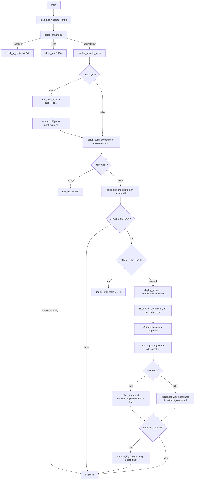

# build_apk.sh — AOSP System APK Build & Deployment Toolkit

An automated developer workflow script for building and deploying privileged system applications (`priv-app`) in **AOSP / Android Automotive** environments (Qualcomm QSSI architecture):

**lunch → build module → root & remount → push APK → reboot / fast restart → capture logcat**

| File | Purpose |
|---|---|
| `build_apk.sh` | Core execution script (orchestration logic, aliases `telua` & `tel`) |
| `config/apk.config` | Active project configuration (profile selection, lunch targets, deploy flags, debug tags) |
| `config/overlay/apk_overlays.config.example` | Template for personal/private project overrides (auto-copied by `tel init`) |
| `config/overlay/apk_overlays.config` | Local confidential project overrides (untracked in Git, preserved across updates) |
| `config/overlay/const_my_cli.config.example` | Template for personal private pipelines & macros (`tel my <action>`) |
| `config/overlay/const_my_cli.config` | Personal private pipelines & macros (untracked in Git, preserved across updates) |
| `python/config_overlay.py` | Smart overlay merge engine (merges `config/overlay/apk_overlays.config` onto `apk.config`) |
| `python/config_crypto.py` | Encrypt / decrypt private overlay configs (`apk_overlays.config`, `const_my_cli.config`) via PBKDF2 + Fernet (`tel crypto`, `tel enc`, `tel dec`) |
| `config/const_car.config` | Global AAOS Car & Audio ADB key injection commands configuration (`tel car`) |
| `config/const_dumpsys.config` | Global Dumpsys & AAOS diagnostics commands configuration (`tel dump`) |
| `config/const_security.config` | Global Security, SELinux & permissions diagnostics configuration (`tel sec`) |
| `config/const_multi_cli.config` | Global Multi-command sequential pipelines & macros with fail-fast safety (`tel run`) |
| `config/const_git.config` | Frequently used Git & Google Repo commands cheatsheet (`tel git`) |
| `config/const_docker.config` | Frequently used Docker daemon, container & image commands cheatsheet (`tel docker`) |
| `config/const_network.config` | Frequently used Network, Port & ADB over Wi-Fi commands cheatsheet (`tel network`) |
| `config/const_clean_java.config` | Configuration for `clean_java.py` and `google-java-format` checks |
| `src/telua_clean.sh` | Java source code hygiene, style auto-fixer, static report & AI skill linker (`tel java`) |
| `python/clean_java.py` | Enforces Java whitespace, tab expansion, keyword spacing, K&R braces & Google Java Style |
| `python/unused_methods_report.py` | 6-in-1 static Java report: unused methods, unused params, whitespace, `google-java-format`, unused imports & unused private fields (`tel java report`) |
| `src/telua_web.sh` & `web/telua_web.py` | Config Manager, BI Studio, Hardware Power & AI Agent Web UI (`tel web start`) |
| `web/ai/telua_web_ai.py` | Autonomous AI Agent blueprint & ReAct loop (modularized with `llm_providers.py`, `agent_tools.py`, `ai_notify.py`) |
| `web/ai/ai_notify.py` | Telegram error alerts, **🛡 Safe Mode** (redacts logs/code), `read_telegram_messages` & 2-way remote listener |
| `web/ai/telua_web_tasks.py` | Task Manager (`Today` / `1–2w Sprint` / `3M Roadmap`) with comments (`👤 User` / `🤖 AI`) & monthly/yearly archives in `ai_agent/data/task/` |
| `web/ai/telua_web_schedule.py` | Background scheduler for recurring AI Agent triggers (Daily / Weekdays / Interval) with optional Telegram summary |
| `web/ai/code_structure_engine.py` | AST & Pygments Perception Engine: outline mode, complete symbol extraction & boundary snapping |
| `web/ai/telua_mcp_skill.py` | Multi-source MCP Skills manager, multi-threaded background sync (live progress + cancel) & A12-A16 versioning |
| `web/ai/db/` | Pluggable sharded `VectorDB` interface (`base.py`), sharded ChromaDB backend (`chroma/`) & Weaviate template (`weaviate/`) |
| `web/ai/ai_config_paths.py` | Centralized AI config resolver: shared (`config/ai_agent/`) vs git-ignored private/runtime (`config/overlay/ai_agent/`) |
| `web/telua_web_power_controls.py` | Hardware Power Switch: dual-output relay (Main Power & Ignition ACC) with state persistence & event history |
| `config/ai_agent/` | Shared AI configs tracked in Git (`ai_providers.json`, `ai_providers.template.json`, `mcp_skills_config.json`) |
| `config/target_power_state.json` | Persistent hardware relay state & switch history log |
| `web/telua_web_bi.py` | BI Studio backend: Excel/CSV to JSON converter, multi-sheet consolidator & cross-tab report engine |
| `bi_studio/` | Sample multi-tab generic business Excel workbooks (Retail, HR, IT, Finance) with dynamic auto-discovery |
| `src/telua_docs.sh` & `sphinx/` | Sphinx Doc-as-Code manager with 4 project templates & live preview (`tel docs`) |
| `src/telua_completion.sh` | Bash and Zsh Tab Auto-completion engine with auto-reload (`tel <Tab><Tab>`) |
| `requirements.txt` | Python package dependencies (`cryptography`, `flask`, `sphinx`, `chromadb`) |

---

## 1. Prerequisites

> [!IMPORTANT]
> **Linux Only:** AOSP compilation tools (`build/envsetup.sh`, `lunch`, Soong, Ninja, and `m`) are strictly designed for Linux environments (e.g., Ubuntu LTS). This script cannot run directly on Windows Command Prompt or PowerShell. If editing on Windows, ensure files maintain Linux (LF) line endings before pushing to your Linux build host.

- **Linux build host** with an initialized AOSP source tree adhering to `.../android/qssi/` (must contain `build/envsetup.sh`).
- **ADB** (`platform-tools`) installed and accessible in `$PATH`.
- **Target Device** running a **`userdebug`** or **`eng`** build image. Production `user` builds strictly disallow `adb root` and `adb remount` (script will safely abort).
- **Python 3** with `cryptography` package (automatically installed during `./build_apk.sh --install` via `requirements.txt`, or install manually):
  ```bash
  python3 -m pip install -r requirements.txt
  ```
- Exactly **one** ADB device/DUT connected.
- Execute permissions and Linux (LF) line endings:
  ```bash
  chmod +x build_apk.sh src/*.sh python/*.py
  dos2unix build_apk.sh src/*.sh config/*.config config/overlay/*.example python/*.py  # required if files were transferred from Windows
  git update-index --chmod=+x build_apk.sh python/config_crypto.py python/config_overlay.py # preserves 100755 in Git
  ```

---

## 2. Quick Start & CLI Installation

### Step 1: One-Time CLI Installation
Make the scripts executable and install the global `telua` & `tel` aliases into your `~/.bashrc` (this also automatically installs required Python packages from `requirements.txt`):

```bash
# 1. Grant execution permissions
chmod +x build_apk.sh src/*.sh python/*.py

# 2. Install 'telua' & 'tel' commands and Tab Auto-completion into ~/.bashrc
./build_apk.sh --install

# 3. Open a new terminal tab (recommended), or reload current session:
source ~/.bashrc
```

Now you can invoke `telua` (or short alias `tel`) anywhere in your terminal!
- **Tab Auto-completion**: Type `tel ` or `telua ` then press <kbd>Tab</kbd> twice to see available subcommands and options (`build`, `car`, `dump`, `run`, `replace`, etc.). Subcommands like `car` and `dump` also auto-complete their respective actions (e.g. `tel car ks<Tab>`).
- Run `telua` with no arguments to display the interactive help menu.

### Step 2: Build & Deployment

Place `apk.config` (or run `telua init`) inside your project directory within the AOSP tree:

```bash
# 1. Select ACTIVE_PROJECT and verify your lunch target
nano apk.config

# 2. Inspect target, module paths, and connected device info
telua info

# 3. Build module, push to system partition, and reboot (or: telua b)
telua build

# Or fast deploy after editing Java/Kotlin source files (5-10s):
telua build --no-reboot
```

> **AOSP Discovery:** The script resolves the AOSP root by walking upwards from its directory until it finds an ancestor directory named `android`, setting `ANDROID_TOP=<...>/android/qssi`.

---

## 3. Multi-Workspace Architecture (`--softlink`)

Maintain **a single golden copy of `build_apk.sh`** shared across multiple independent AOSP checkouts, release branches, or workspaces. Each workspace maintains its own standalone `apk.config`.

```
~/code/telua_aosp/                      ← Master Repository (edit logic here)
├── build_apk.sh                        ← Master CLI engine & orchestration logic (aliases: telua, tel)
├── src/                                ← 19 modular Bash domain scripts (telua_android.sh, telua_car.sh, ...)
├── python/                             ← Python automation & static analysis scripts
│   ├── clean_java.py                   ← Google/AOSP Java Style auto-fixer
│   ├── unused_methods_report.py        ← 6-in-1 static Java analyzer
│   ├── config_overlay.py               ← Smart overlay merge engine (merges overrides into apk.config)
│   └── config_crypto.py                ← Private overlay encryption utility (PBKDF2 + Fernet AES)
├── web/                                ← Config Manager Web UI & BI Studio (telua_web.py + telua_web_bi.py)
├── bi_studio/                          ← Generic multi-tab Excel workbooks (Retail, HR, IT, Finance)
├── sphinx/                             ← Sphinx Doc-as-Code templates & build scripts
├── requirements.txt                    ← Python dependencies
├── AI.md                               ← AI Assistant & LLM instruction reference
└── config/                             ← Shared constants, project configs, macros & cheatsheets
    ├── apk.config                      ← Master active configuration profile
    ├── const_car.config                ← AAOS car & audio key injections
    ├── const_dumpsys.config            ← System dumpsys diagnostics
    ├── const_security.config           ← SELinux & security diagnostics
    ├── const_clean_java.config         ← Java cleaner & google-java-format settings
    ├── const_multi_cli.config          ← Multi-command sequential pipelines
    ├── const_docker.config             ← Docker & systemd cheatsheet
    ├── const_git.config                ← Git & Google Repo cheatsheet
    ├── const_network.config            ← Network & Wi-Fi debugging cheatsheet
    └── overlay/                        ← Personal / private configs (git-ignored plaintext, AES-encryptable)
        ├── ReadMe.txt                  ← Mapping guide for personal overlay files
        ├── apk_overlays.config.example ← Personal override template (auto-copied by tel init)
        ├── const_my_cli.config.example ← Personal private pipeline macro template
        ├── apk_overlays.config         ← Local confidential project overrides (git-ignored)
        ├── const_my_cli.config         ← Local personal pipeline macros (git-ignored)
        └── enc_*.config                ← Encrypted private overlay backups (created via tel enc)

~/ws_main/android/qssi/tools/           ← Local Workspace (created via telua init / --softlink)
├── build_apk.sh  -> (symlink to master build_apk.sh)
├── apk.config        (ACTIVE_PROJECT="oem_service", merged with config/overlay/apk_overlays.config)
├── OemService.apk    (Build output artifact copied here)
└── deployment_log.txt
```

### Installing to a Workspace

You can either pass the target path directly via CLI, or configure `SOFTLINK_TARGET_PATH` inside `apk.config`:

```bash
# Option A: Specify destination directly
mkdir -p ~/ws_main/android/qssi/tools
./build_apk.sh --softlink ~/ws_main/android/qssi/tools

# Option B: Pre-configure SOFTLINK_TARGET_PATH="/home/user/ws_main/android/qssi/tools" in apk.config
./build_apk.sh --softlink
```

`--softlink [path]` automatically performs:
1. Validates that the target path is inside an AOSP tree (under an `android/` directory).
2. Automatically creates the destination directory (`mkdir -p`) if its parent directory exists.
3. Creates `<path>/build_apk.sh` as a **symbolic link** pointing to the canonical master script.
4. **Copies** `apk.config` adjacent to the calling script into `<path>/apk.config`.
5. Safely **overwrites** existing links and files if present.

### Working Inside Each Workspace

```bash
cd ~/ws_main/android/qssi/tools
nano apk.config          # configure ACTIVE_PROJECT="oem_service", target A
./build_apk.sh --info
./build_apk.sh

cd ~/ws_release/android/qssi/tools
nano apk.config          # configure ACTIVE_PROJECT="car_audio", target B
./build_apk.sh
```

### Why This Architecture Works
- **Centralized Logic Updates:** Fixes and enhancements made to master `build_apk.sh` propagate instantly to every linked workspace without manual syncing.
- **Isolated Per-Project Configs:** Each workspace independently manages its `ACTIVE_PROJECT`, lunch target, CPU threads, and debug tags.
- **Context-Aware Path Resolution:** The script detects the `android/` root relative to the **location of the symlink**, not the master script. Executing the link in `ws_main` builds `ws_main`.
- **Isolated Artifacts:** Generated APKs and `deployment_log.txt` are created locally inside the workspace tools directory.

### Important Caveats
- Re-running `--softlink` against an existing directory will **overwrite `apk.config`** in that directory. Back up any customized config beforehand.
- New variables added to the master `apk.config` will not automatically backport to existing copies. The script relies on defaults (`${VAR:-...}`), but manual addition is needed to customize new flags.
- Symlinks placed outside an `android/` directory tree will trigger a warning and will fail to resolve `ANDROID_TOP`.
- Do not run deployments concurrently from two workspaces targeting the same physical device.

---

## 4. Command Line Options

| Option / Subcommand | Description |
|---|---|
| *(none)*, `-h`, `--help`, `help` | Displays interactive help menu, subcommands, and configuration file paths |
| `build`, `b`, `--build` | Full cycle: Build module + Push APK (if `ENABLE_DEPLOY="true"`) + Full Device Reboot |
| `test`, `t`, `--test` | Run project unit test suite (shortcut for `--test-mode true`) |
| `-p <name>`, `--profile <name>` | Switch `ACTIVE_PROJECT` profile in `apk.config` (persists to file) and build/run |
| `--no-reboot` | Fast runtime restart (`stop && start`, ~10–15s) instead of full device reboot |
| `--config <path>` | Explicitly specifies path to `apk.config` to load |
| `--init`, `init` | Initializes `apk.config` in current directory (`$PWD`), auto-creates missing personal configs from `*.example`, enforces script permissions, and merges `apk_overlays.config` via `config_overlay.py` |
| `--install`, `install` | Adds or updates aliases `telua` & `tel` and registers Tab Auto-completion (`src/telua_completion.sh`) in `~/.bashrc` |
| `-v`, `--version`, `version` | Displays script version, release update date, and exits |
| `--info`, `info` | Displays general build configuration followed by platform-specific target info (Android / QNX), then exits |
| `--platform android\|qnx` | Target deployment platform: `android` (default, active) or `qnx` (reserved, currently skips deployment) |
| `--start-deploy true\|false` | Overrides `ENABLE_DEPLOY` defined in `apk.config` |
| `--softlink [path]` | Creates symlink to `build_apk.sh` and copies `apk.config` to `[path]` (falls back to `SOFTLINK_TARGET_PATH` from `apk.config` if omitted) |
| `--repo-sync`, `sync` | Executes `repo sync` from `ROOT_DIR`, navigates to `android/qssi`, and runs `post_sync_cli` before building |
| `--repo-sync-only` | Executes `repo sync` and `post_sync_cli` only, then exits without building |
| `--repo-reset`, `reset` | Executes `repo forall -c "git reset --hard && git clean -xdf"` (requires interactive `y` confirmation; bypass with `-y`) |
| `-y`, `--yes` | Bypasses interactive confirmation prompts for dangerous operations (e.g., `--repo-reset`) |
| `--git-diff` | Displays `git diff HEAD^ HEAD` in the script's git repository and exits |
| `--git-amend` | Runs `git commit --amend --no-edit` (staged changes only) and exits |
| `--update`, `update` | Updates this toolkit repository via `git pull origin main` (auto-backs up & restores personal configs, auto-recovers hard reset on conflict) |
| `--git-help`, `git` | Displays cheatsheet of commonly used Git commands and exits |
| `--docker-help`, `docker` | Displays cheatsheet of commonly used Docker commands and exits |
| `--network-help`, `network` | Displays cheatsheet of commonly used Network & Port commands and exits |
| `car [action]`, `audio [action]` | Controls car/audio via ADB shell (`vol-up`, `vol-down`, `vol-mute`, `ks`, `ks-stop`, `car-status`) using commands from `config/const_car.config` |
| `--dump`, `dump [target]` | Runs dumpsys diagnostics via ADB shell (`audio`, `car-service`, `car-audio`, `media`, `battery`, `activity`) using commands from `config/const_dumpsys.config` |
| `sec [action]`, `security [action]` | Controls SELinux and runs security diagnostics (`status`, `perm`, `enforce`, `avc`, `privapp`, `appops`, `keystore`, `policy`, `root`, `unroot`, `remount`, `disable-verity`) using `config/const_security.config` |
| `docs [action]`, `doc [action]` | Sphinx Doc-as-Code manager (`init [-t <tpl>]`, `sync`, `build`, `clean`, `start [port]`, `serve`, `check`) using templates in `sphinx/` |
| `web [action]` | Config Manager Web UI (`start [port]`, `stop`, `status`, `restart [port]`, `log`, `help`) powered by Flask (`web/telua_web.py`) |
| `crypto [action]`, `enc`, `dec` | Check, encrypt, or decrypt private configs (`apk_overlays.config`, `const_my_cli.config`) in `config/overlay/` (`status`, `encrypt`/`enc`, `decrypt`/`dec`) |
| `--run`, `run [group]` | Executes multi-command sequential pipeline group from `config/const_multi_cli.config` (alias: `telua multi [group]`) |
| `my [action]`, `proj [action]` | Executes personal private pipeline macro from `config/overlay/const_my_cli.config` (`telua my hello`) |
| `java [target]` | Auto-cleans & fixes style in `.java` files (`diff`: current Git commit `HEAD` + working tree \| `all`: all files \| `<file\|dir>` \| `skill`: link `.skill/java/`; alias: `clean-java`) |
| `java report [t]` | 6-in-1 static Java report: unused methods, unused params, whitespace, `google-java-format`, unused imports & unused private fields (`t`: `diff` \| `all` \| `<file\|dir>`; saved to `unused_java_report.txt`) |
| `--find-file <pattern> [path]` | Searches for files by pattern in `[path]` (defaults to `.` if omitted) |
| `--find-dir <pattern> [path]` | Searches for directories by pattern in `[path]` (defaults to `.` if omitted) |
| `--find-text <text> [path]` | Greps for text string in files under `[path]` (defaults to `.` if omitted) |
| `replace <old> <new> [path]` | Finds & replaces text across files under `[path]` (defaults to `.` if omitted; alias: `--replace`) |
| `--test-mode true\|false` | Runs unit test suite instead of compiling the APK (or use `tel t` / `tel test`) |

#### Usage Examples:
```bash
telua                                 # View interactive help menu & available subcommands
telua build                           # Build active module, push APK, and reboot device
telua build --no-reboot               # Fast deploy after editing Java/Kotlin code (~5-10s)
telua b                               # Short alias for 'telua build'
telua b -p car_audio                  # Switch ACTIVE_PROJECT to 'car_audio' in apk.config & build
telua t                               # Run unit test suite (shortcut for 'telua --test-mode true')
./build_apk.sh --install              # Install/update 'telua' & 'tel' aliases + Tab completion in ~/.bashrc
telua init                            # Initialize workspace & apply apk_overlays.config
telua info                            # Inspect environment and device state
telua update                          # Update toolkit: pulls origin/main & preserves personal configs
telua java                            # Auto-clean & fix style for current Git commit (HEAD) + modified .java files
telua java diff                       # Explicitly clean & fix style for current Git commit (HEAD) + working tree
telua java all                        # Clean & fix style in ALL .java files across the workspace
telua java packages/apps/Car/         # Clean & fix style under a specific folder or file
telua java report                     # 6-in-1 report: unused methods/params/imports/fields, whitespace & style
telua java report diff                # Report on current Git commit (HEAD) + modified .java files
telua java report all                 # Report across the whole workspace
telua java skill                      # Link .skill/java/ knowledge base & skills into current workspace
telua web start                       # Launch Config Manager Web UI in background & open browser
telua web status                      # Check Web UI server status, PID, port & health
telua web stop                        # Stop background Web UI server
telua crypto                          # Check existence & sync state of private configs in config/overlay/
telua enc                             # Encrypt existing apk_overlays.config & const_my_cli.config in config/overlay/
telua dec                             # Decrypt enc_apk_overlays.config & enc_const_my_cli.config in config/overlay/
telua car vol-up                      # Increase volume (AAOS inject-key 24) (or: telua audio vol-up)
telua car vol-down                    # Decrease volume (AAOS inject-key 25)
telua car vol-mute                    # Mute volume (AAOS inject-key 164)
telua car ks                          # Start KitchenSink test app (or: telua audio ks)
telua car ks-stop                     # Force stop KitchenSink test app
telua dump audio                      # Dump audio service status (or: telua --dump audio)
telua dump car-service                # Dump AAOS CarService state
telua dump car-audio                  # Dump AAOS CarAudioService
telua sec                             # View security & SELinux command cheatsheet (or: telua security)
telua sec status                      # Check SELinux mode, build type, secure/debuggable props
telua sec perm                        # Set SELinux to Permissive mode (setenforce 0)
telua sec enforce                     # Set SELinux to Enforcing mode (setenforce 1)
telua sec avc                         # Dump SELinux AVC audit denials from logcat & dmesg
telua sec privapp                     # Dump priv-app permissions & whitelist violations
telua sec root                        # Restart adbd daemon with root privileges
telua run                             # View all pipeline macro groups and steps (or: telua multi)
telua run audio-cycle                 # Run KitchenSink restart & volume test pipeline
telua run dev-prep                    # Run device prep pipeline (root, remount, debug tags)
telua my hello                        # Run personal private macro from config/const_my_cli.config
telua git                             # View Git cheatsheet (or: telua --git-help)
telua docker                          # View Docker daemon & container cheatsheet
telua network                         # View Network & Port cheatsheet
./build_apk.sh --find-file "*.bp" packages/apps/Car # Find Android.bp files in specific path
./build_apk.sh --find-dir "Oem*" .    # Find directories matching pattern
./build_apk.sh --find-text "DEBUG_TAG" src/ # Grep text string inside files
telua replace "curent_Text" "new_text" . # Replace text across directory (or: --replace)
telua replace "old_str" "new_str" src/app.c # Replace text in specific file
./build_apk.sh --git-diff             # View diff of the last commit
./build_apk.sh --git-amend            # Amend staged changes to the last commit
./build_apk.sh --start-deploy false   # Compile APK only, do not push to device
./build_apk.sh --no-reboot            # Fast deploy after editing Java source files
./build_apk.sh --repo-sync            # Sync repo from ROOT_DIR, then build and deploy
./build_apk.sh --repo-sync --repo-reset # Hard reset all repos, then sync and build
./build_apk.sh --repo-sync-only       # Sync repo and execute post_sync_cli hook only
./build_apk.sh --test-mode true       # Execute project test runner
```

> **When to avoid `--no-reboot`:** Perform a full device reboot if you modified `AndroidManifest.xml` (permissions, exported components, new services), SELinux `.te` policies, or added a brand new system app.

---

## 5. Configuration Reference (`apk.config`)

### 5.1 Project Profiles (`ACTIVE_PROJECT`)

```bash
ACTIVE_PROJECT="oem_service"   # "oem_service" | "car_audio" | "vehicle_service"  
```

Each profile case defines the module parameters:

| Variable | Description |
|---|---|
| `MODULE_TYPE` | Artifact type: `"apk"` (default) for Android APK, or `"bin"` for native binary/daemon (`cc_binary` in `Android.bp`). Controls clean strategy, `chmod` mode (755 vs 644) and post-deploy restart behavior (killall daemon vs reboot framework) |
| `MODULE_NAME` | AOSP compilation module identifier passed to `m <MODULE_NAME>`. Corresponds to `name:` in `Android.bp` or `LOCAL_PACKAGE_NAME` in `Android.mk`. If omitted, defaults to `${APK_FILE_NAME%.apk}` |
| `SOURCE_CODE_RELATIVE_PATH` | Path to module source directory relative to `ANDROID_TOP` (see details below) |
| `APK_OUTPUT_RELATIVE_PATH` | Target output directory relative to `ANDROID_TOP` (**cleaned before each build**) |
| `APK_FILE_NAME` | Expected output binary filename (e.g., `OemService.apk`) |
| `APK_DEPLOY_PATH` | Destination system directory on target device (e.g., `/system/priv-app/OemService`) |
| `DEFAULT_LOGCAT_FILTER` | Default regex filter for logcat capture |
| `DEFAULT_DEBUG_LOG_TAGS` | Default log tags to enable at `DEBUG` level for this service |

#### 💡 Source Code Directory Note (`SOURCE_CODE_RELATIVE_PATH`):
The directory specified by `SOURCE_CODE_RELATIVE_PATH` must contain the build and manifest definition files:
* **`Android.bp` (Soong build system):**
  Defines the module via `android_app { name: "OemService", srcs: [...], privileged: true }`. The `name` attribute is your `MODULE_NAME`.
* **`Android.mk` (GNU Make system):**
  Defines `LOCAL_PACKAGE_NAME := OemService` or `LOCAL_MODULE := OemService`.
* **`AndroidManifest.xml`:**
  Defines package name, shared user IDs (`android:sharedUserId="android.uid.system"`), system permissions, and services. Changes here require a full device reboot.

*To add a new service profile:* Copy an existing `"..." ) ... ;;` case block, update the paths, and set `ACTIVE_PROJECT` to your new profile name.

#### 💡 Native Binary Profiles (`MODULE_TYPE="bin"`):
For native daemons/binaries (`cc_binary` in `Android.bp`, e.g. `dlt-daemon`, `inc-log-adapter`), set `MODULE_TYPE="bin"` in the profile case. Differences vs `"apk"`:
* **Build:** cleans only the previous artifact file (`rm -f`) instead of the whole output directory (`rm -rf`)
* **Deploy:** `adb push` + `chmod 755` (executable) instead of `chmod 644` + oat cache cleanup
* **Restart:** kills & restarts the daemon via `killall`/`pkill` instead of rebooting the Android framework
* **Output:** binary lands in `out/target/product/<device>/system/bin` (or `vendor/bin` for `vendor: true` modules)

### 5.1b Softlink Target Workspace

| Variable | Default | Description |
|---|---|---|
| `SOFTLINK_TARGET_PATH` | `""` | Default workspace destination when running `./build_apk.sh --softlink` without specifying `<project_path>` via CLI |

---

### 5.2 Build Environment

| Variable | Description |
|---|---|
| `TARGET_PLATFORM` | Target deployment platform: `"android"` (default, fully supported via ADB) or `"qnx"` (reserved for QNX Hypervisor, skips direct deploy) |
| `AOSP_TOP_REL_PATH` | Relative path to AOSP build root from `ROOT_DIR`. Examples: `"android/qssi"` (Qualcomm QSSI) or `"android"` (MediaTek / NXP / pure AOSP / QNX Android container). Defaults to auto-detecting `android/qssi` if present, otherwise `android`. |
| `CONFIG_TARGET_PRODUCT` | Target product for `lunch` (e.g., `abc_xyz_in`) |
| `CONFIG_TARGET_BUILD_VARIANT` | Target build variant (`userdebug` or `eng`) |
| `ENV_VAR_PRODUCT_NAME` | Name of environment variable exported by `lunch` for target product (default: `"TARGET_PRODUCT"`). Customizable for vendor BSPs |
| `ENV_VAR_VARIANT_NAME` | Name of environment variable exported by `lunch` for target build variant (default: `"TARGET_BUILD_VARIANT"`). Customizable for vendor BSPs |
| `BUILD_JOBS` | Parallel compilation threads (`-j`). Leave empty `""` to auto-detect via `nproc` (fallback: 8) |

> **Active Shell Optimization:** If the current terminal session already has an active environment (variables defined by `ENV_VAR_PRODUCT_NAME` and `ENV_VAR_VARIANT_NAME` are set), the script **skips `envsetup.sh` and `lunch`** to save execution time.

### 5.2b Repo Sync & Two-Stage Post-Sync CLI Hooks

All repo-related options are explicitly prefixed with `REPO_` to clearly distinguish them from the single-module APK build configuration:

| Variable | Default | Description |
|---|---|---|
| `REPO_SYNC_JOBS` | `"4"` | Number of parallel jobs for `repo sync` (`-j4`) |
| `REPO_SYNC_FLAGS` | `"-d -c --force-sync --no-clone-bundle --tags"` | Complete clean flags passed to `repo sync` |
| `REPO_ENABLE_RESET` | `"false"` | Runs `repo forall -c "git reset --hard && git clean -xdf"` before sync (can also trigger via `--repo-reset`) |
| `REPO_POST_SYNC_ROOT_COMMAND` | `""` | CLI command executed in `ROOT_DIR` right after repo sync (**BEFORE** `cd android/qssi`, e.g., BSP setup, vendor scripts) |
| `REPO_POST_SYNC_BUILD_COMMAND` | `""` | CLI command executed in `ANDROID_TOP` (**AFTER** entering `android/qssi`, e.g., full project rebuild `m -j16`) |

---

### 5.3 Device Deployment & Diagnostics (Android / ADB)

| Variable | Default | Description |
|---|---|---|
| `ENABLE_ANDROID_DEPLOY` | `"true"` | Enables or disables pushing APK to connected Android device (also supports legacy `ENABLE_DEPLOY`) |
| `ENABLE_DEBUG_LOG` | `"true"` | Automatically sets debug log properties on the device |
| `DEBUG_LOG_LEVEL` | `"DEBUG"` | Target logging level (`DEBUG` or `VERBOSE`) |
| `DEBUG_LOG_TAGS` | profile default | Space-separated log tags (e.g., `"CarAudioService CarZones"`) |
| `ENABLE_ANDROID_LOGCAT` | `"false"` | Captures post-deployment logcat to file (also supports legacy `ENABLE_LOGCAT`) |
| `LOGCAT_FILTER` | profile default | Regex filter for `adb logcat -d \| grep -E` |
| `LOGCAT_SETTLE_SECONDS` | `"10"` | Seconds to wait after restart before dumping logcat buffer |

Debug tags are activated via persistent system properties:
```bash
adb shell setprop persist.log.tag.<TAG> DEBUG
```
This ensures `Log.isLoggable(TAG, Log.DEBUG)` returns `true` in Java code and persists across reboots.

---

### 5.3b AAOS Car & Audio Control (`config/const_car.config`)

ADB volume control commands and audio test app (KitchenSink) triggers are centrally managed in **`config/const_car.config`** (located in the toolkit's `config/` directory), invoked via `telua car [action]` or `telua audio [action]`:

| Variable | Default | Description |
|---|---|---|
| `ADB_SHELL_CAR_UP` | `"dumpsys car_service inject-key 24"` | Command executed for `vol-up` (AAOS CarInputService inject key 24) |
| `ADB_SHELL_CAR_DOWN` | `"dumpsys car_service inject-key 25"` | Command executed for `vol-down` (AAOS CarInputService inject key 25) |
| `ADB_SHELL_CAR_MUTE` | `"dumpsys car_service inject-key 164"` | Command executed for `vol-mute` (AAOS CarInputService inject key 164) |
| `ADB_SHELL_CAR_KS_START` | `"am start com.google.android.car.kitchensink/.KitchenSinkActivity"` | Launch KitchenSink test app |
| `ADB_SHELL_CAR_KS_STOP` | `"am force-stop com.google.android.car.kitchensink"` | Force-stop KitchenSink test app |
| `ADB_SHELL_CAR_STATUS` | `"dumpsys car_service --list"` | List all services registered in CarService |
| `CAR_CLI_LIST` | Array of CLI actions (`vol-up`, `vol-down`, `vol-mute`, `ks`, `ks-stop`, `status`) | Action list displayed when running `telua car` or `telua audio` |

> **Device Connection Safety (`device offline`):**
> Before executing any ADB command (such as `telua car ks`), the system automatically verifies device connectivity (`check_car_device_connected` in `src/telua_car.sh`). If no device is connected or if it is offline/unauthorized, execution immediately halts with a descriptive error: `[ERROR] device offline: No Android device connected.` (or `Connected Android device is not ready`).

> **Configuration Separation Notes:**
> - `config/const_car.config` is a pure declarative configuration file containing no executable logic, maintaining shared defaults across all projects.
> - Project-specific customizations can directly override these variables in `apk.config` or `apk_overlays.config`.

---

### 5.3c Dumpsys & Diagnostics (`config/const_dumpsys.config`)

ADB system diagnostics dumpsys commands are centrally managed in **`config/const_dumpsys.config`** (invoked via `telua dump <target>` or `telua --dump <target>`):

| Variable | Default | Description |
|---|---|---|
| `ADB_SHELL_DUMP_AUDIO` | `"dumpsys audio"` | Command for `telua dump audio` (standard AudioService) |
| `ADB_SHELL_DUMP_CAR_SERVICE` | `"dumpsys car_service"` | Command for `telua dump car-service` (AAOS CarService) |
| `ADB_SHELL_DUMP_CAR_AUDIO` | `"dumpsys car_audio"` | Command for `telua dump car-audio` (AAOS CarAudioService) |
| `ADB_SHELL_DUMP_MEDIA_SESSION` | `"dumpsys media_session"` | Command for `telua dump media` |
| `ADB_SHELL_DUMP_BATTERY` | `"dumpsys battery"` | Command for `telua dump battery` |
| `ADB_SHELL_DUMP_ACTIVITY` | `"dumpsys activity top"` | Command for `telua dump activity` |
| `DUMP_CLI_LIST` | Array of 6 diagnostic targets | Diagnostic items displayed when running `telua dump` |

---

### 5.3d Multi-Command Sequential Pipelines (`config/const_multi_cli.config`)

Multi-step sequential workflows (pipelines / macros) are centrally configured in **`config/const_multi_cli.config`** (invoked via `telua run <group>` or `telua multi <group>`):

| Variable / Group | Commands in Pipeline | Purpose |
|---|---|---|
| `MULTI_CMD_AUDIO_CYCLE` | `am force-stop` $\rightarrow$ `sleep` $\rightarrow$ `am start` $\rightarrow$ `inject-key 24/25` | Restart KitchenSink cycle and verify volume key injection |
| `MULTI_CMD_DEV_PREP` | `adb root` $\rightarrow$ `adb remount` $\rightarrow$ `setprop persist.log.tag.* DEBUG` | Acquire root privileges, remount, and enable CarAudio debug logging |
| `MULTI_CMD_REMOUNT_REBOOT` | `adb root` $\rightarrow$ `adb remount` $\rightarrow$ `adb reboot` | Root, remount system partition, and reboot device |
| `MULTI_CMD_AUDIO_DUMP` | `dumpsys audio` $\rightarrow$ `dumpsys car_audio` $\rightarrow$ `dumpsys media_session` | Collect comprehensive system audio diagnostic dump |
| `MULTI_CMD_LOGCAT_START` | `wait-for-device` $\rightarrow$ `kill old pid` $\rightarrow$ `logcat -c` $\rightarrow$ `nohup adb logcat ... &` | Wait for device, terminate stale process, clear buffer, and logcat to file |
| `MULTI_CMD_LOGCAT_STOP` | `kill $(cat .logcat.pid) \|\| pkill adb logcat` $\rightarrow$ `ls -lh device_logcat.log` | Stop host logcat process and display output file size |
| `MULTI_GROUP_LIST` | Registered pipeline group list | Lookup table displayed when running `telua run` |

> **Fail-Fast Mechanism:** If any command in the pipeline returns a non-zero exit code (`exit code != 0`), execution aborts immediately and pinpoints the failing step, preventing unstable device states.

---

### 5.3e Personal Pipelines (`config/overlay/const_my_cli.config`)

Developer personal sequential workflows are configured in **`config/overlay/const_my_cli.config`** (automatically initialized from `config/overlay/const_my_cli.config.example` during `tel init`, invoked via `telua my <action>` or alias `telua proj <action>`):

| Variable / Action | Commands in Pipeline | Purpose |
|---|---|---|
| `MY_CMD_HELLO` | `echo "Hello World"` $\rightarrow$ `sleep 1` | Sample action printing Hello World and sleeping 1s |
| `MY_GROUP_LIST` | List of registered personal actions | Lookup table displayed when running `telua my` |

---

### 5.3f Java Source Hygiene, Static Report & AI Skills (`telua java` / `src/telua_clean.sh`)

Automated Java source hygiene tools (`python/clean_java.py` and `python/unused_methods_report.py` driven by wrapper `src/telua_clean.sh`), enforcing Google / AOSP Java Style and running a 6-tier static audit:

```bash
tel java                    # Scan and automatically clean .java files in HEAD commit + working tree
tel java diff               # Equivalent to above
tel java all                # Scan and clean ALL .java files across the entire workspace
tel java <path>             # Clean a specific .java file or all files in directory <path>
tel java report             # 6-tier static audit on current directory (saved to unused_java_report.txt)
tel java report <t>         # Report on target: diff | all | <file|dir>
tel java skill              # Generate .skill/java/ directory linking knowledge base & AI skills
tel java help               # Show detailed usage instructions
```

**`tel java report`** (`python/unused_methods_report.py`) executes a **6-tier static audit** in **Read-Only** mode (never alters source files):
- **[1] Unused methods**: declared methods whose names do not appear anywhere in code (stripping strings/comments) within the file's module `src/`. Automatically ignores constructors, `@Override`, interface/abstract methods, `main()`, `Object` overrides (`toString`/`equals`/`hashCode`), and JUnit test files/methods (`@Test`, `@RunWith`, `test/`/`androidTest/`).
- **[2] Unused parameters**: parameters unreferenced in method bodies (`-Wunused-parameter` warning, exempts `main(String[] args)`). Fixes by commenting parameter names while preserving types: `void f(int data, int /*spare*/)`.
- **[3] Whitespace violations**: read-only preview of formatting issues addressed by `tel java`: trailing whitespace, leading tabs, control keyword spacing (`if(x)` $\rightarrow$ `if (x)`), consecutive blank lines ($\ge 2$ lines), and `CRLF` line endings.
- **[4] google-java-format violations**: verifies compliance with Google / AOSP Java Style (detects missing space before `{` / after `,`, `{` on new line, missing braces around `if` / `else`, line length > 100 chars; supports downloading `google-java-format` JAR to `third_party/google-java-format/`).
- **[5] Unused imports**: flags redundant imports unused in source code or Javadoc (skips wildcard `.*`).
- **[6] Unused private fields**: detects private member variables declared but never read/written outside their declaration line (exempts `serialVersionUID`, `TAG`, `LOG_TAG`).

Report is saved to `unused_java_report.txt` (customize filename with `--out FILE` when calling python directly):

```bash
tel java report src/com/example/app/MyService.java
```

---

### 5.4 Unit Tests

| Variable | Description |
|---|---|
| `TEST_RELATIVE_PATH` | Path to test suite directory relative to script/repo directory (`tests`) |
| `TEST_BUILD_SCRIPT` | Executable test runner script (e.g., `run_unittest_test.sh`) |

---

### 5.4b QNX Target Configuration (Reserved for Future Use)

Placeholder variables reserved in `config/apk.config` for future QNX Hypervisor / Guest VM deployment workflows:

| Variable | Default | Description |
|---|---|---|
| `ENABLE_QNX_DEPLOY` | `"false"` | Enables or disables deploying to QNX target environment (reserved, default: false) |
| `ENABLE_QNX_LOG` | `"false"` | Enables or disables capturing slog2 logs on QNX target (reserved, default: false) |
| `QNX_HOST_IP` | `"192.168.1.100"` | QNX Target Hostname or IP address |
| `QNX_SSH_PORT` | `"22"` | Target SSH / SCP communication port |
| `QNX_TARGET_DIR` | `"/var/opt/apps"` | Destination filesystem directory on QNX target |

---

### 5.5 Private Overlay Encryption & Security (`tel crypto` / `python/config_crypto.py`)

Encrypt and decrypt private configuration files in **`config/overlay/`** (`apk_overlays.config` and `const_my_cli.config`) to safeguard internal paths, confidential project settings, and personal macros before backing up or sharing across Git:

* **Cryptographic Scheme**: PBKDF2-HMAC-SHA256 (600,000 iterations) with a unique 16-byte random salt per file to derive a 256-bit encryption key for [Fernet](https://cryptography.io/en/latest/fernet/) (AES-128-CBC + HMAC-SHA256).
* **Format**: Base64 text `base64(salt(16 bytes) || Fernet token)`, safe to commit to Git (`!config/overlay/enc_*.config` is whitelisted in `.gitignore`, while plain-text `config/overlay/*.config` is strictly ignored).
* **File Permissions**: Output files are assigned restrictive filesystem permissions (`0600` / owner read-write only).
* **Smart Existence Detection (Fast-Fail)**: Before prompting for a password, `tel crypto` automatically checks the presence of `apk_overlays.config` and `const_my_cli.config` (or `enc_*.config`). Existing files are processed automatically.

#### Commands & Usage:

```bash
# 1. Check status of private files and encrypted payloads in config/overlay/:
tel crypto                            # Or: tel crypto status / tel crypto check

# 2. Encrypt existing private files in config/overlay/ (prompts for hidden passphrase):
tel enc                               # Or: tel crypto encrypt / tel encrypt

# Or pass passphrase directly on CLI:
tel enc "MySecretPassword"

# 3. Decrypt enc_*.config in config/overlay/ back to plain text:
tel dec                               # Or: tel crypto decrypt / tel decrypt

# 4. Encrypt / decrypt an arbitrary custom file:
tel enc -i my.config -o my_enc.config
tel dec -i my_enc.config -o my_dec.config
```

| Action | Default Targets in `config/overlay/` | Output in `config/overlay/` | Behavior |
|---|---|---|---|
| `tel crypto status` | `apk_overlays.config`, `const_my_cli.config` | *(read-only status table)* | Reports `SYNCED`, `MODIFIED`, `UNENCRYPTED`, `ENCRYPTED ONLY`, or `NOT CREATED` |
| `tel enc` (`encrypt`) | `apk_overlays.config`, `const_my_cli.config` *(if present)* | `enc_apk_overlays.config`, `enc_const_my_cli.config` | Encrypts all existing private files using the same passphrase |
| `tel dec` (`decrypt`) | `enc_apk_overlays.config`, `enc_const_my_cli.config` *(if present)* | `apk_overlays.config`, `const_my_cli.config` | Decrypts and restores personal configuration files |

---

### 5.5b Personal Overrides & Smart Merge (`config/overlay/apk_overlays.config` & `python/config_overlay.py`)

The toolkit supports personal and private override mechanisms to maintain strict separation between base configuration (`config/apk.config`) and developer-specific or confidential parameters (`config/overlay/`):

* **Personal Configuration File:** `config/overlay/apk_overlays.config` (decrypted from `enc_apk_overlays.config` or automatically created from `config/overlay/apk_overlays.config.example` during `tel init`).
* **Zero Git Leak:** `config/overlay/*.config` is included in `.gitignore`, permanently preventing accidental commits of internal paths or proprietary project profiles to Git.
* **Smart Merge Rules (`python/config_overlay.py`):**
  1. **Top-level variables:** Top-level variables (`ACTIVE_PROJECT`, `BUILD_JOBS`, `CONFIG_TARGET_PRODUCT`, ...) are substituted in-place inside `apk.config`.
  2. **Case branch merge:** Profile branches within `case "$ACTIVE_PROJECT" in` (e.g. `"oem_service")`) are merged independently per branch. Other branches (`car_audio`, `vehicle_service`) remain unaffected.
  3. **Custom profile addition:** Declaring a new profile (e.g. `"my_custom_service")`) causes the merge engine to automatically inject the new branch immediately before the default `*)` branch.
  4. **Multi-command macros:** Supports multi-line arrays (such as `MULTI_CMD_CUSTOM_SETUP=(...)`).

```bash
# Test merge results without modifying files (Dry-run mode):
python3 python/config_overlay.py ./apk.config --dry-run
```

---

### 5.6 Toolkit Auto-Update (`telua update` / `--update`)

Automatically updates the toolkit's master repository to the latest commit from `origin/main` with end-to-end protection for personal configurations:

```bash
tel update
# Or:
./build_apk.sh --update
```

* **Personal Configs Protection:**
  1. Prior to running `git pull`, the script automatically backs up personal files in `config/overlay/` (`config/overlay/apk_overlays.config` and `config/overlay/const_my_cli.config`) to temporary `/tmp/`.
  2. Fetches and pulls latest code from `origin/main`.
  3. **Self-Healing / Auto-Recovery:** If a merge conflict or dirty tree is detected, the script triggers `git fetch origin main` and `git reset --hard origin/main`.
  4. After updating, personal files are **automatically restored intact** from the temporary backup, ensuring private configs are never lost.
  5. Automatically synchronizes Git submodules (`repos/`) and restores execution permissions (`chmod +x`) across all scripts.

---

### 5.7 Bash & Zsh Tab Auto-completion Engine (`src/telua_completion.sh`)

Double-tab completion (<kbd>Tab</kbd><kbd>Tab</kbd>) features an **Auto-Reload** mechanism that automatically reloads when `src/telua_completion.sh` is updated:

```bash
# Automatically install into ~/.bashrc:
tel install

# Then open a new terminal tab or run:
source ~/.bashrc
```

**Key Capabilities:**
- **Dual Alias Recognition & Auto-Reload:** Operates identically for both `telua ` and `tel `, inspecting `src/telua_completion.sh` timestamp (`mtime`) to reload immediately upon changes without requiring `source ~/.bashrc`.
- **Level-1 Suggestions (Subcommands & Options):** Pressing `tel <Tab><Tab>` displays all primary commands (`build`, `b`, `test`, `t`, `sync`, `reset`, `car`, `dump`, `sec`, `java`, `docs`, `web`, `crypto`, `enc`, `dec`, `run`, `my`, `replace`, `info`, `init`, ...).
- **Context-Aware Suggestions:**
  - `tel b -p <Tab><Tab>` / `tel --profile <Tab><Tab>`: Automatically reads available profiles from `apk.config` / `config/apk.config` (`oem_service`, `car_audio`, `vehicle_service`, ...).
  - `tel web <Tab><Tab>`: Suggests `start`, `stop`, `status`, `restart`, `log`, `help`.
  - `tel crypto <Tab><Tab>`: Suggests `status`, `check`, `encrypt`, `decrypt`, `enc`, `dec`, `help`.
  - `tel java <Tab><Tab>`: Suggests `clean`, `diff`, `all`, `report`, `skill`, `help`.
  - `tel java report <Tab><Tab>`: Suggests `diff`, `all`, `help` and file/directory paths.
  - `tel docs <Tab><Tab>`: Suggests `start`, `serve`, `sync`, `metadata`, `build`, `check`, `clean`, `init`, `help`.
  - `tel docs init -t <Tab><Tab>`: Suggests Sphinx templates (`basic`, `architecture`, `minimal`, `api`).
  - `tel car <Tab><Tab>`, `tel dump <Tab><Tab>`, `tel sec <Tab><Tab>`, `tel run <Tab><Tab>`, `tel my <Tab><Tab>`: Automatically extracts registered actions from `config/const_*.config` and `config/overlay/const_my_cli.config`.

---

### 5.8 Security, SELinux & Diagnostics Control (`telua sec` / `telua security`)

Android / AAOS system security audit and diagnostics control via `src/telua_security.sh` and declarative configuration `config/const_security.config`:

```bash
tel sec                               # Display quick-reference security command table
tel sec help                          # Show detailed action descriptions with underlying ADB commands
```

| Action | Function | Executed Command |
|---|---|---|
| `host` | Audit Linux build host security environment (OS, LSM, ulimit, /tmp, keys) | Direct inspection on Linux host (no device required) |
| `status` | Comprehensive device security posture check | `getenforce`, `ro.build.type`, `ro.debuggable`, `ro.secure`, `partition.system.verified` |
| `perm` | Switch SELinux to Permissive mode for debugging | `adb shell setenforce 0` |
| `enforce` | Switch SELinux back to Enforcing mode | `adb shell setenforce 1` |
| `avc` | Inspect SELinux policy violation audit denials | Greps `avc:` from `logcat -d -b all` and `dmesg` |
| `privapp` | Dump Privileged App permissions & whitelists | `dumpsys package --privapp-permissions` / `cmd package dump-privapp-permissions` |
| `appops` | Query AppOps permissions and operational restrictions | `cmd appops query-op --user 0` / `dumpsys appops` |
| `keystore` | Extract Android Keystore status | `dumpsys keystore` |
| `policy` | Extract DevicePolicyManager configuration | `dumpsys device_policy` |
| `root` | Restart adbd with root permissions | `adb root` |
| `unroot` | Restart adbd in non-root mode | `adb unroot` |
| `remount` | Remount system partitions as read-write | `adb remount` |
| `disable-verity` | Disable dm-verity partition verification | `adb disable-verity` |

> **Safety Notice:** Like `telua car`, all `telua sec` commands automatically verify device connectivity prior to execution, aborting with `[ERROR] device offline: ...` if the target is disconnected.

---

### 5.9 Sphinx Doc-as-Code Management (`telua docs` / `doc`)

Modular technical documentation system built on **Sphinx** and the **Furo** theme, supporting 4 specialized templates (`basic`, `architecture`, `minimal`, `api`) with automated scaffolding, `metadata.json` synchronization, integrity validation, and instant browser preview:

```bash
# 1. Initialize documentation in ./docs (supports selecting from 4 templates):
tel docs init                         # Interactive template selection (defaults to 'basic')
tel docs init -t architecture         # Initialize using architecture template (basic | architecture | minimal | api)

# 2. Validate section paths and image references:
tel docs check

# 3. Synchronize new files/folders into metadata.json:
tel docs sync                         # Extracts titles, creates chapter wrappers, populates 'must update'

# 4. Merge sections and compile static HTML:
tel docs build

# 5. Start HTTP server and launch browser preview (default port 8789):
tel docs start                        # Builds if needed & launches browser at http://localhost:8789
tel docs start 8789                   # Custom port
tel docs serve                        # Alias for start

# 6. Clean build output directory:
tel docs clean

# 7. Upgrade legacy project to support PlantUML (persists into conf.py):
tel docs upgrade [dir]                # Alias: tel docs sync-config
```

#### PlantUML Diagrams (`.. uml::` / `.. plantuml::`)

Author diagrams directly in `.rst` files. **No local Java/PlantUML installation required**: during compilation, diagrams render to SVG images (`_build/html/_images/plantuml-*.svg`) and embed via `` tags.

```rst
.. uml::

   @startuml
   actor User
   participant "Frontend" as UI
   participant "Backend" as API
   database "Database" as DB
   User -> UI : Submit
   UI -> API : REST call
   API -> DB : Query
   @enduml
```

* **Compilation Strategy** ([`sphinx/scripts/plantuml_wrapper.py`](sphinx/scripts/plantuml_wrapper.py)): checks `plantuml` command in PATH $\rightarrow$ `java -jar plantuml.jar` (`PLANTUML_JAR` env) $\rightarrow$ online `plantuml.com` server $\rightarrow$ fallback placeholder image on network outage.
* **New Templates** (`tel docs init`): pre-configured with PlantUML support in `conf.py`.
* **Legacy Projects** (`conf.py` lacking PlantUML):
  * **Automatic**: `tel docs build` / `tel docs start` / Web UI Build dynamically injects configuration into staged `conf.py` in `_build/.staging`. Original source file **remains untouched**.
  * **Permanent Upgrade**: `tel docs upgrade [dir]` appends configuration block (marked `# --- telua-plantuml-autoconfig ---`) to `conf.py`, copying `plantuml_wrapper.py` and `_telua_static/telua_plantuml.css`. Recommended when sharing repositories or running standalone `sphinx-build`. Idempotent across repeated executions.
  * Preserves existing settings: only appends missing extensions; replaces `plantuml` only if current executable fails; updates `plantuml_output_format` only when unset or currently set to `'svg'` (migrates to `'svg_img'`).

---

### 5.10 Google/AOSP Java Style Hygiene & Static Audit (`telua java` / `clean-java`)

Module `src/telua_clean.sh` combines `python/clean_java.py` and `python/unused_methods_report.py` to automate code formatting and run static source audits:

```bash
# 1. Clean .java files in current Git commit (HEAD) + uncommitted changes (Working Tree):
tel java
tel java diff

# 2. Scan and clean ALL .java files across the workspace:
tel java all

# 3. Clean a specific file or directory:
tel java src/com/example/MyService.java

# 4. Generate 6-tier static audit report (Read-only, saved to unused_java_report.txt):
tel java report                       # Scan entire current directory
tel java report diff                  # Scan files in current Git commit (HEAD) + working tree

# 5. Link knowledge base & AI Skills (.skill/java/) to current project:
tel java skill
```

* **Issues Automatically Fixed In-Place by `tel java diff` and `tel java all`**:
  1. **Tabs & Whitespace**: Converts leading `\t` to 4 spaces, removes trailing whitespace, converts `CRLF` $\rightarrow$ `LF`, consolidates consecutive blank lines.
  2. **Control Keyword Spacing**: `if(x)` $\rightarrow$ `if (x)`, `if ( x )` $\rightarrow$ `if (x)` for `if`, `for`, `while`, `switch`, `catch`, `try`, `synchronized`.
  3. **Brace & Comma Spacing**: `public class Foo{` $\rightarrow$ `public class Foo {`, `if (x){` $\rightarrow$ `if (x) {`, `}else{` $\rightarrow$ `} else {`, `foo(a,b)` $\rightarrow$ `foo(a, b)`.
  4. **K&R Style §4.1.2 Opening Braces**: Moves standalone `{` onto preceding line: `void f()\n{` $\rightarrow$ `void f() {`.
  5. **Mandatory Braces for `if (...)` and `else` (Google Java Style §4.1.1)**:
     - `if (a > 0) return;` $\rightarrow$ structured `if (a > 0) {\n    return;\n}` block.
     - `if (a < 0)\n    a = 0;\nelse\n    a = 1;` $\rightarrow$ wrapped `{ ... } else { ... }`.
* **String & Comment Protection**: Contents within `"..."`, `'...'`, `//`, and `/* ... */` are 100% preserved.

---

### 5.11 Config Manager & Web Dashboard (`telua web` / `web/telua_web.py`)

Comprehensive browser-based management interface (Flask backend + Vanilla JS frontend with zero external dependencies) via `src/telua_web.sh` and `web/telua_web.py`:

```bash
tel web start                         # Launch background Web UI (default port 8788) & open browser
tel web start 9000                    # Launch on custom port
tel web status                        # Check server status (PID, URL, health probe /api/ping, uptime)
tel web restart                       # Restart Web UI server
tel web log                           # Stream server log (.telua_web.log)
tel web stop                          # Stop Web UI server
```

#### 🌟 Key Modules & Features on Web Dashboard:

1. **📄 Files Tab — Safe Configuration Management & Editor**:
   - **Automatic Scanning & Classification**: Lists base project configs (`config/apk.config`), private security overlays (`config/overlay/*.config`), and constant macros (`config/const_*.config`) with size, mtime, and read-only status.
   - **Instant Search Filter**: Quickly filters files by keyword in the sidebar.
   - **Safe View (Lock/Edit mode)**: Defaults to read-only mode to prevent unintended changes; unlocked by clicking `✎ Edit`.
   - **Draft Persistence**: Unsaved modifications are cached in `localStorage` (displaying a `✎ draft` badge), preventing data loss on page refreshes or accidental tab closures.
   - **Pre-Save Syntax Validation**: Runs `bash -n` for shell/config files and `json.loads` for JSON files before saving, blocking malformed saves.
   - **Automatic Backup & Diff**: Creates timestamped `.bak` files before overwriting and provides visual side-by-side diff comparisons.

2. **⚡ Pipelines Tab — Visual Macro Designer & Execution Engine**:
   - **Multi-Source Pipeline Support**: Easily toggles between configuration categories:
     - `MY`: Private developer macros (`const_my_cli.config` / `tel my <action>`)
     - `MULTI`: Sequential coordinated workflows (`const_multi_cli.config` / `tel run <group>`)
     - `CAR`: AAOS vehicle key injection & audio tests (`const_car.config` / `tel car <action>`)
     - `DUMP`: Subsystem dumpsys diagnostics (`const_dumpsys.config` / `tel dump <target>`)
   - **Step Editor**: Add, rename groups, modify descriptions, add/edit/delete commands, and reorder execution sequence.
   - **Live Streaming Logs**: Click `▶ Run` to execute pipelines with real-time Server-Sent Events (SSE) output streaming, featuring `⏹ Stop` (SIGINT abort), `↻ Re-run`, and `📋 Copy output`.

3. **🖥 System Tab — System Administration & Docker Pipelines**:
   - Integrates directly with `config/const_system_cli.config` (`tel system <action>`).
   - Provides visual controls for OS service health, disk cleanup, Docker container lifecycle management, and network reachability tests.

4. **💻 Terminal Tab — Interactive Web CLI Console**:
   - Browser-embedded CLI console executing any `tel`, Bash, Git, ADB, or system utility.
   - **Real-Time SSE Streaming**: Line-by-line streaming identical to native terminal sessions.
   - **Process Control**: Includes `⏹ Stop` sending safe `SIGINT` (Ctrl+C) signals to terminate hung or long-running tasks.
   - Quick-action shortcuts (e.g., `tel system ram`, `git status -s`, `df -h`, `tel --network-help`).

5. **📚 Docs Tab — Sphinx Doc-as-Code & Visual Editor**:
   - **Bidirectional Editing (RST $\leftrightarrow$ HTML)**: Modern visual editor (**Quill.js**, 100% offline) enabling WYSIWYG documentation authoring without needing strict RST syntax.
   - **Automatic Bidirectional Conversion**: Converts smoothly between HTML and reStructuredText (RST) via `docutils` and Python parser engine (`web/telua_web_docs.py`), preserving headings, lists, tables (`.. list-table::`), images (`.. image::`), `code-block` blocks, callout boxes (`.. note::`, `.. warning::`), Mermaid (`.. mermaid::`), and PlantUML diagrams (`.. uml::` / `.. plantuml::`).
   - **3 Flexible Work Modes**:
     - 🎨 *Visual*: Author using an intuitive rich-text interface.
     - 📝 *Raw RST*: Directly edit reStructuredText source with monospace typography.
     - 👁 *Split View*: Side-by-side authoring with real-time Live HTML Preview.
   - **Directory Management & File Picker**: Automatically indexes 46+ documentation files across Sphinx templates (`architecture`, `api`, `basic`, `minimal`, `docs/`), with **📁 Change Dir** to switch to any project documentation root.
   - **Safety & Build/Preview Controls**: Generates `.rst.bak` prior to saving, accompanied by **🔨 Build Docs** for direct compilation and **🚀 Start Docs** to launch background preview server on `http://localhost:8789`.

6. **🎛 Top Statusbar & Global Modals**:
   - **Active Project Switching**: Click `project: <name>` chip to open a modal switching `ACTIVE_PROJECT` in `apk.config` with 1 click (auto `.bak` backup).
   - **🔐 Crypto Overlay Management (`#modal-crypto`)**: Click `🔐 crypto` chip to inspect encryption status of confidential overlays (`apk_overlays.config`, `const_my_cli.config`), prompting for passphrase to `Encrypt` (to `enc_*.config`), `Decrypt`, or `Decrypt & Override`.
   - **Real-Time System Monitoring**: Live counters for connected ADB devices and build-host RAM utilization.
   - **5 Theme Color Palettes (Theme Selector)**: Instantly switch between 🌙 *Dark (Default)*, 💎 *Jade (Emerald)*, 🌊 *Ocean (Deep Blue)*, 🔮 *Amethyst (Purple)*, and ☀️ *Light*, persisting preferences across sessions.
   - **Quick Actions Bar**: Shortcuts for `tel info` (environment/device info) and `tel run unittest` (executing 120+ unit test suite) with detailed terminal modal.

7. **📊 BI Studio Tab — Power BI-Style Analytics Engine**:
   - **Schema-Agnostic Ingestion**: Drag-and-drop or upload Excel (.xlsx, .xls), CSV, TSV files, or paste tables from clipboard. Automatically infers column types: Numbers (🔢 NUM), Text (🔤 TXT), Dates (📅 DATE), Booleans (🔘 BOOL).
   - **4 Dynamic KPI Metric Cards**: Computes and displays Total Records, Numeric Metric Sum, Categorical Groups, and Total Columns.
   - **Multi-Dimensional Slicers & Input Filters**:
     - **Flexible Input Filter**: Filter values with autocomplete datalist and Enter key shortcut.
     - **Cascade Multi-Select Serial**: Dropdown checklist to select specific Vehicle Series / Serials, synchronizing with filtered OEM brand and displaying selection badge (`2 / 10`).
     - Interactive filter chips for categorical dimensions with cross-filtering across all visuals.
   - **Interactive Chart Cross-Highlighting**: Clicking on any Column, Bar, or Donut Chart slice:
     - Selected element highlights with a glow border.
     - Unselected elements dim in opacity, matching Power BI Desktop behavior.
     - Whole dashboard immediately filters to selection; clicking again clears filter.
     - **Selected vs. Remaining (20% / 80%)**: When selecting a hierarchical subset, Donut chart presents Selected **20% (2 Serials)** vs Remaining **80% (8 Serials)** with center badge `SELECTED 20% (2 / 10)`.
   - **Drag & Drop Canvas**:
     - **Reorder Widgets**: Drag handle **⋮⋮** on card headers to reposition visuals across dashboard grid (HTML5 Drag & Drop).
     - **Responsive Resizing**: Toggle **⤢** between single column (50%) and full-width 2 columns (100%).
   - **Calculated Columns & Measures (Mini-DAX)**:
     - **fx Measure** button enables custom arithmetic formulas: `+`, `-`, `*`, `/`, `( )` using `[Column_Name]` syntax.
     - 1-click formula presets: Profit Margin (([Profit] / [Revenue]) * 100), Variance ([Actual] - [Budget]), Product ([Price] * [Quantity]).
     - Computed columns display **fx CALC** badge in Fields list.
   - **Multi-Tab Sheet Tabs Bar**: Bottom tabs bar similar to Excel/Power BI, with automated **All_Sheets (Combined)** union view.
   - **Cross-Tab Relational Report & Sphinx Docs**: **📑 Multi-Tab Report** detects Join Keys across sheets, builds comparative matrices, renders Mermaid ER Diagrams, and offers 1-click **📚 Open in Docs** export to Sphinx.
   - **Visual Builder & GUI Chart Manager**: **＋ Add Visual** to create Combo, Column, Bar, Line, Donut charts or Interactive Tables. `⚙️ Config JSON` includes visual GUI management (Add, Edit, Delete, Reorder, Resize, Import/Export JSON).
   - **Business Dataset Templates**: Discovers business Excel templates in `bi_studio/` (global_retail_sales.xlsx, hr_workforce_analytics.xlsx, it_project_portfolio.xlsx, financial_budget_opex.xlsx).
   - **Bidirectional Data Export**: Export filtered data to JSON ({} JSON) or Excel .xlsx (⬇ Excel).

8. **🤖 AOSP Center — Project Source Root Execution & Automation**:
   - **Source Root Alignment**: Automatically runs `tel b` / `tel test` inside active project's source directory (`<AOSP_TOP>/<SOURCE_CODE_RELATIVE_PATH>`, e.g., `.../android/qssi/vendor/bosch/services/car/oemcarservice`), without manual `cd`. Console header indicates `(cd <source_dir>)`.
   - **Automatic `apk.config` Scaffolding**: Selecting a project profile automatically creates `<source_dir>/apk.config` from template, merges `config/overlay/apk_overlays.config`, and sets `ACTIVE_PROJECT="<project>"`.
   - **Status Verification**: Hovering over **Source** pill inspects absolute path and config status. Backend exposes `source_dir`, `source_dir_exists`, `apk_config_in_source` via `GET /api/aosp/config`.
   - **1-Click APK Deployment**: `⚡ Upload & Deploy APK` pushes compiled APK directly to `/system/priv-app/` or `/product/app/` and restarts the package.

9. **📱 Mirror Tab — Screen Mirroring & Android Remote Control (Zero-Dependency)**:
   - **Canvas Streaming**: Captures device framebuffer via `adb exec-out screencap -p` onto HTML5 Canvas without requiring `scrcpy`, `ffmpeg`, or extra drivers.
   - **Target Resolution Detection**: Reads physical and override display resolutions via `adb shell wm size` and density via `wm density`. Auto-adapts to landscape (`1920×1080`) or portrait (`1080×1920`). Recognizes `TARGET_PRODUCT` (e.g. `car_x86_64`) for offline preview frame.
   - **Interactive Remote Control**: Touch tap, swipe, and scroll mapped 1:1 to target coordinates with touch ripple animation. Virtual hardware buttons (`◀ Back`, `⌂ Home`, `▢ Recents`, `⚡ Power`, `🔔 Notifications`, `🔊 Vol+`, `🔉 Vol-`, `⚙ Settings`). Keyboard text injection via `adb shell input text`. High-resolution PNG screenshots via `📸 Screenshot`.
   - **Background Streaming**: Stream continues in background when switching tabs; Mirror tab shows active pulse badge `.tab-streaming`.

10. **📋 Logcat Studio Tab — Real-time Android Logcat Analyzer**:
    - **Real-Time Streaming**: Multi-tier filtering by Log Level (`V`, `D`, `I`, `W`, `E`, `F`), AAOS/AOSP tags, PID, and regex.
    - **Filter Persistence**: Stores filters in `config/overlay/logcat_filters.json` (personal) or `config/logcat_filters.json` (shared).
    - **Auto-Recovery**: Detects disconnects and generates `adb_remote_pc.bat` script for remote re-connection.

---

### 5.12 Remote Work & Remote Lab Setup

Telua Web is engineered for remote development (Work from Home / Remote Lab) without requiring physical access to the build server or hardware boards:

#### 🚀 Method 1: SSH Port Forwarding (Recommended — Zero Code Changes, Maximum Security)

This is the simplest and most secure approach because all traffic (Mirror, Logcat, Terminal) tunnels through your existing encrypted SSH connection:

1. **Launch Telua Web on Linux build server in office/lab:**
   ```bash
   tel web start                         # Launch background server on port 8788
   ```

2. **On local machine (Windows PowerShell, macOS, or Linux Terminal), run:**
   ```bash
   ssh -L 8788:localhost:8788 user@remote_server_ip
   ```
   *(Replace `user@remote_server_ip` with your SSH credentials)*

3. **Open browser:**
   👉 Navigate to: `http://localhost:8788`
   - Complete Telua Web interface, Screen Mirroring, Logcat streaming, and Terminal execution operate seamlessly as if you were working locally!

---

#### 🌐 Method 2: Internal LAN or VPN (Tailscale, WireGuard, OpenVPN)

When both the workstation and remote client join the same VPN network (such as **Tailscale**, **WireGuard**, or corporate VPN):

1. **Launch Web UI binding to all network interfaces (`--host 0.0.0.0`):**
   ```bash
   python3 web/telua_web.py --host 0.0.0.0 --port 8788
   ```
   *Or set environment variables in `~/.bashrc`:*
   ```bash
   export TELUA_WEB_HOST="0.0.0.0"
   export TELUA_WEB_PORT="8788"
   tel web start
   ```

2. **Open browser on remote machine:**
   👉 Navigate to: `http://<SERVER_IP>:8788` (e.g., `http://100.85.120.45:8788` via Tailscale or `http://192.168.1.50:8788` on office LAN).

---

#### ☁️ Method 3: Cloudflare Zero Trust Tunnel (Free, HTTPS & Custom Domain)

For secure remote access across the public internet without port forwarding:

1. Install `cloudflared` on the Linux build host.
2. Launch a quick tunnel to Telua Web:
   ```bash
   cloudflared tunnel --url http://localhost:8788
   ```
3. Cloudflare provisions a secure HTTPS URL (e.g., `https://your-domain.trycloudflare.com`) accessible from any browser.

---

#### 🔌 Method 4: Remote Hardware / Android Board Connection (Remote ADB Bridge)

When a physical Android device or automotive board is plugged into your local Windows PC via USB, but AOSP source code and build environments reside on a remote Linux server:

1. In Telua Web, click the offline device banner or open:
   `http://<server-ip>:8788/api/adb/remote-script`
2. Browser automatically downloads `adb_remote_pc.bat`.
3. Run `adb_remote_pc.bat` on the Windows PC with the connected device: the script establishes an `adb forward` reverse bridge to the remote Linux server. The **📱 Mirror** and **📋 Logcat** tabs will recognize the device immediately!

---

## 6. Execution Lifecycle

When executed, `build_apk.sh` follows this strict sequential pipeline:



1. **Config Validation:** Loads `apk.config` and verifies presence of all mandatory parameters.
2. **AOSP Path Discovery:** Resolves `ROOT_DIR` and `ANDROID_TOP` (`.../android/qssi`).
3. **Repo Sync (Optional via `--repo-sync`):** Navigates to `ROOT_DIR`, runs `repo sync` with timing benchmarks, switches into `$ANDROID_TOP`, and executes `post_sync_cli` hook.
4. **Environment Setup:** Sources `build/envsetup.sh` and invokes `lunch` target.
5. **Module Compilation:** Cleans stale artifacts in `$DIR_OUT` and compiles specific target: `m "$MODULE_NAME" -j"$BUILD_JOBS"`. Copies the output APK to the local script folder.
6. **Remount & Verification:** Acquires root (`id -u == 0`), runs `adb remount`, and performs an active write probe (`touch .build_apk_rw_test`). Automatically manages overlayfs/scratch initial reboot cycles if detected.
7. **Payload Push:** Transfers APK to `$APK_DEPLOY_PATH`, enforces `chmod 644`, wipes obsolete Dalvik/ART cache (`rm -rf oat/`), and invokes `sync`.
8. **Property Configuration:** Injects `persist.log.tag.<TAG>` settings for all configured tags.
9. **Buffer Reset:** Executes `adb logcat -c` to flush historical log buffer.
10. **Reboot / Restart:**
   - *Default:* Reboots device, waits for disconnect, waits for device reconnect, and blocks until `sys.boot_completed=1`.
   - *Fast Mode (`--no-reboot`):* Invokes `stop && start`, blocks until `system_server` acquires a new PID and `pm path android` answers.
11. **Log Diagnostics:** Sleeps `LOGCAT_SETTLE_SECONDS`, dumps `adb logcat -d`, filters lines via regex, and saves to `deployment_log.txt`.

---

## 7. Troubleshooting Guide

| Issue / Error | Root Cause & Resolution |
|---|---|
| `Could not find the 'android' root directory` | Script or symlink is outside an `android/` source tree. Verify location or inspect with `./build_apk.sh --info`. |
| `Cannot find 'build/envsetup.sh'` | CWD does not match expected Qualcomm `android/qssi` tree. Check ancestor paths. |
| `Failed to initialize target environment variables after lunch` | Invalid `CONFIG_TARGET_PRODUCT` or `CONFIG_TARGET_BUILD_VARIANT`. Ensure lunch target exists in lunch menu. |
| `APK not found ... after build completed` | Mismatch between `MODULE_NAME` and `Android.bp` `name:`. Verify module name via `grep 'name:' Android.bp`. |
| `Device is running a 'user' build! 'adb remount' is forbidden` | Target hardware has a secure production build. Flash a `userdebug` or `eng` flash image. |
| `adbd is not running as root after 30s` | Device build restricts root or ADB daemon hung. Execute `adb kill-server && adb root` manually. |
| `... is still read-only after 'adb remount'` | DM-verity enabled on partition. Run `adb disable-verity && adb reboot`, then re-run script. |
| `error: more than one device/emulator` | Multiple devices/emulators connected. Disconnect secondary devices; script expects a single DUT. |
| `Fast restart failed ... did not come back` | System service crashed on startup or failed to restart. Re-run without `--no-reboot` to trigger clean boot. |
| `Captured log is empty` | Application didn't start within timeout or regex filter mismatched. Increase `LOGCAT_SETTLE_SECONDS` or broaden `LOGCAT_FILTER`. |
| Newly pushed code changes not executing | Code change involves manifest, permissions, or system signatures requiring full reboot. Remove `--no-reboot`. |
| `/bin/bash^M: bad interpreter` | Windows CRLF line endings present. Run `dos2unix build_apk.sh apk.config`. |

---

## 8. Community & Contributing

Contributions from the developer community are welcome! Whether you are adding new automotive shortcuts, improving diagnostic dumps, or hardening build orchestration, please read our contribution guide:

👉 **[Contribution Guidelines & Workflow](CONTRIBUTING.md)**

### Quick Guidelines:
* **Zero Cognitive Load:** Ensure interactive help and self-documenting cheatsheets exist for all CLI additions.
* **Enterprise Safety:** Require `[y/N]` interactive confirmation for any destructive actions.
* **Separation of Concerns:** Keep core logic in `build_apk.sh`, declarative commands in `const_*.config`, and project specifics in `apk.config`.
* **Line Endings:** Enforce Linux `LF` line endings (`dos2unix`).
* **Universal Language:** All code comments, help strings, and documentation must be written in professional English.

---

## 9. AI Agent Architecture: AI Model + Telua Harness

The toolkit features an autonomous, enterprise-grade AI coding and diagnostic agent (**Tel Agent**) integrated directly into the Web UI (`tel web start` → **🤖 AI Agent** tab).

### 9.1 Conceptual Clarity: Agentic AI vs. AI Agent
To understand how modern autonomous engineering systems operate, it is crucial to distinguish between the design paradigm and the resulting entity:

| Concept | Nature & Role | In This Toolkit |
| :--- | :--- | :--- |
| **Agentic AI** *(Paradigm & Methodology)* | The **architectural design philosophy** that empowers AI systems with autonomy, multi-step planning, tool invocation, and iterative self-correction (reflection)—as opposed to passive, single-shot text generation (Standard GenAI). | The **ReAct autonomous loop** in `telua_web_ai.py` that inspects code, runs builds, reads compiler errors, and refactors until tests pass. |
| **AI Agent** *(Concrete Entity / Instance)* | The **active software system** ($\text{Model} + \text{Harness}$) tasked with achieving specific engineering objectives. | **Tel Agent**: The specialized, on-premise AOSP & Android Automotive AI Engineer. |

#### The Four Core Patterns of Agentic AI:
1. **Planning:** Decomposing complex multi-file engineering tasks into step-by-step actions without user micro-management.
2. **Tool Use (Actuators):** Autonomously invoking compilers (`run_tel`), AST parsers (`read_file`), and vector databases (`search_knowledge`).
3. **Reflection & Self-Correction:** Reading compiler/test error streams, identifying syntax or logic bugs, and self-patching code across iterative turns.
4. **Multi-Step Execution:** Looping through thought-action-observation cycles rather than giving up after one single prompt.

### 9.2 Spectrum of Agency: Single-Agent vs. Multi-Agent Systems
A common misconception is that "Agentic AI must always consist of multiple agents." In reality, *Agentic* defines the **spectrum of autonomous capability**, categorized into two execution paradigms:

| Architectural Tier | Structure & Mechanics | Strengths & Trade-offs | Where Tel Agent Fits |
| :--- | :--- | :--- | :--- |
| **Tier 1: Single-Agentic Workflow** *(Current Tel Agent)* | **A single high-focus agent** operating inside an autonomous ReAct loop ($\text{Perceive} \rightarrow \text{Plan} \rightarrow \text{Act} \rightarrow \text{Observe} \rightarrow \text{Self-Correct}$). | • **Sub-second latency:** Zero inter-agent meeting/coordination overhead.<br>• **Token Efficiency:** No redundant prompt echoing between agents.<br>• **Deterministic control:** No conflicting consensus loops or hallucination propagation. | **The Production Sweet Spot:** Perfectly handles 90%+ of engineering tasks (reading multi-thousand line ASTs, running AOSP builds, fixing regressions, querying versioned skills). |
| **Tier 2: Multi-Agent Swarm** *(Enterprise Scaling)* | **A squad of specialized agents** (Planner $\rightarrow$ Coder $\rightarrow$ Build Engineer $\rightarrow$ Reviewer) communicating over a message bus. | • **Cross-system audits:** Ideal for nocturnal CI/CD repairs, repository-wide migration, and strict adversarial code review.<br>• **High latency & token cost:** Multi-minute consensus delays and multiplied API token bills. | Scalable blueprint: Telua's modular Harness is already decoupled to support fanning out specialized subagents when full subsystem migration is required. |

> [!TIP]
> **Why Tel Agent's Current Architecture is Optimal:**  
> Multi-agent architectures deployed prematurely introduce massive token waste and communication latency. Tel Agent strikes the **ideal balance**: it possesses full Agentic capability (tool use, planning, AST code awareness, and self-correction) while remaining blazing fast, token-conservative, and 100% reliable on developer workstations.

### 9.3 The Architectural Formula: AI Agent = AI Model + AI Harness
An LLM alone is merely a next-token predictor—a "brain in a jar" without hands, eyes, long-term memory, or safety shields. **Tel Agent** combines any pluggable LLM with the domain-tailored **Telua Harness**:

$$\text{AI Agent} = \text{AI Model (The Brain)} + \text{AI Harness (Body, Sensors, Memory \& Safety)}$$
$$\text{Tel Agent} = \text{Pluggable LLM (Cloud / On-Premise GPU)} + \text{Telua Automotive Harness}$$

```
+--------------------------------------------------------------------------------------------------+
|                                           TEL AGENT                                              |
+--------------------------------------------------------------------------------------------------+
|  🧠 THE BRAIN (Pluggable LLM Core)                                                               |
|     • Cloud Endpoints: Google Gemini 2.5/Flash, Anthropic Claude 3.5 Sonnet, OpenAI              |
|     • On-Premise / Air-Gapped: Local GPUs running Qwen 2.5 Coder / DeepSeek via Ollama or vLLM   |
+--------------------------------------------------------------------------------------------------+
|  🛠️ THE TELUA HARNESS (Automotive & AOSP Operating Environment)                                  |
|                                                                                                  |
|  [👁️ PERCEPTION: CodeStructureEngine & Pygments AST]                                            |
|     • Structure-Aware Slicing: Eliminates naive line-cutting; preserves full AST and syntax       |
|     • Outline Mode: Instant bird's-eye view of classes, interfaces & methods (< 100 tokens)      |
|     • Symbol Extraction: Extracts complete method bodies from signature to closing brace '}'     |
|     • Smart Boundary Snapping: Automatically snaps line ranges forward to prevent chopped code   |
|                                                                                                  |
|  [🧠 LONG-TERM MEMORY: Sharded Pluggable VectorDB (ChromaDB / Weaviate-ready)]                   |
|     • Sharded by Project + Version: ai_agent/data/shards/<project>__<aosp_version>/ (Zero Leak)  |
|     • Pluggable VectorDB Interface: web/ai/db/ (ChromaDB default; Weaviate template ready)       |
|     • Multi-Threaded Sync: 1 walker -> N readers -> 1 writer/shard + live progress & 30s resume  |
|     • Function-as-a-Chunk: Embeds complete methods with Project, AOSP Version & Class Context    |
|                                                                                                  |
|  [🦾 ACTUATORS: Autonomous Workspace Execution Tools]                                            |
|     • grep_search: Ripgrep / pruned os.scandir fast symbol & regex search across large AOSP trees|
|     • run_tel: Directly executes tel, telua, AOSP make/build, ADB logcat, and dumpsys diagnostics|
|     • write_file & edit_file: Surgical, autonomous code generation and refactoring               |
|     • get_file_git_history & get_commit_diff: Automated git forensics and regression root-causing|
|                                                                                                  |
|  [🛡️ SAFETY SHIELD & ENTERPRISE COMPLIANCE]                                                      |
|     • Destructive Command Blocker: Intercepts dangerous operations (rm -rf, fastboot flash)      |
|     • Public vs Private Overlay: Keeps proprietary OEM code and API keys off Git repositories    |
|     • Token Usage Monitor: Real-time token tracking per month with 6-month historical retention   |
+--------------------------------------------------------------------------------------------------+
```

### 9.4 Perception Engine: `CodeStructureEngine` & AST-Aware Reading
Naively slicing code at arbitrary 150-line boundaries amputates functions in half, breaks syntax trees, and blinds LLMs to class-level member fields. Telua's built-in **`CodeStructureEngine`** ([web/ai/code_structure_engine.py](web/ai/code_structure_engine.py)), powered by `Pygments` and Python `ast`, provides structure-aware inspection:
* **Outline Mode (`read_file(path, outline=True)`):** Generates an architectural tree of all classes, interfaces, and method signatures with exact line spans, allowing the agent to analyze 3,000+ line files in seconds with minimal token consumption.
* **Exact Method Extraction (`read_file(path, method="setVolumeGroupIndex")`):** Locates the method declaration, prepends the enclosing class header, captures Javadoc/docstrings, and extracts the entire function body down to the matching closing brace `}`.
* **Smart Boundary Snapping:** When reading line chunks (`start_line` to `end_line`), the engine detects if `end_line` falls inside an active method body and automatically snaps forward to the closing brace, ensuring no function is ever cut in half.
* **Flexible Read Capacities:** Supports expanding chunk sizes up to 500 lines per read on demand (`max_lines=500`).

### 9.5 Long-Term Memory & Dual-Layer AOSP Versioning (A12 vs A16)
In automotive platforms, CarAudio, CarProperty, and AIDL HAL interfaces mutate significantly across Android releases. Telua enforces **Dual-Layer Version Tagging** across all indexed skills:
1. **In-Document Provenance Header:** Every code chunk indexed into ChromaDB includes a standardized header:
   ```java
   // ==============================================================================
   // PROJECT: aosp_aaos | AOSP_VERSION: a16 | API_LEVEL: 36 | BRANCH: android-16.0.0_r1
   // SOURCE: AOSP A16 Car Audio (aosp_a16_car)
   // FILE: frameworks/opt/car/services/CarAudioService.java (Lines 215-340)
   // CLASS: CarAudioService | METHOD: setVolumeGroupIndex
   // ==============================================================================
   public void setVolumeGroupIndex(int zoneId, int groupId, int index, int flags) { ... }
   ```
2. **Sharded VectorDB & Metadata Filtering:** Each `(project, aosp_version)` pair is stored in its own isolated shard (`ai_agent/data/shards/<project>__<version>/`), so querying A16 only loads the A16 index into RAM and never mixes with A12. Both `search_knowledge` and `/api/ai/chroma/query` support optional `project`, `aosp_version`, and `source_id` filters.
3. **Chat Context Bar & Editable Projects:** Select **🎯 Context (`Project` + `AOSP Version`)** directly on the AI Chat toolbar so every agent search automatically targets the active Android release. Projects (default `aosp_aaos`) are managed via a dedicated modal (add/edit/disable-only, no accidental deletion).
4. **Automated AOSP Version Detection:** The `detect_aosp_version_from_path()` engine automatically scans `build/make/core/version_defaults.mk`, git branches, and folder heuristics to tag A12–A16 versions without manual input.
5. **Cross-Version Migration Analysis:** Enables the Agent to compare A12 and A16 implementations side-by-side to produce precise migration guides for vehicle software engineers.

### 9.6 Autonomous Coding & Direct Workspace Tools
The AI Agent operates inside an iterative thinking loop, selecting and executing workspace tools autonomously:
* **Target Path Bar & Session Persistence:** Set a target path (cached in `localStorage` across refreshes along with chat history and prompt drafts), click `📖 Read / Scan` for situational awareness, or click `⚡ Auto-Code` to refactor files across the target.
* **`grep_search`**: Fast recursive text/regex search powered by `ripgrep` (`rg`) with an automatic pruned `os.scandir` Python fallback across the workspace and configured knowledge sources (skips `.git`, `.repo`, `out`, binaries).
* **`read_file`**: Outline, method extraction, or smart-snapped line-range reads with line numbers (`0042 | code`).
* **`write_file`**: Directly creates or overwrites workspace files with path traversal security.
* **`edit_file`**: Replaces exact code snippets with surgical precision without rewriting whole files.
* **`get_file_git_history` & `get_commit_diff`**: Reads per-file commit logs and inspects code diffs (`git show --stat -p`) for rapid regression diagnostics and root cause analysis.
* **`run_tel`**: Executes compilation checks (`tel build`), hardware commands, ADB queries, and tests, automatically blocking destructive commands (`rm -rf /`, formatting, force pushes).

### 9.7 MCP Skills & ChromaDB Knowledge Base (134 Pre-Indexed Skills)
Local engineering skills and design patterns are indexed in a persistent vector database ([ai_agent/data/](ai_agent/data/)):
* **`telua_skill` (Java_Android):** Vehicle HAL, Power HAL, CarAudioService, CarPropertyService, Audio policy, AIDL / Binder rules.
* **`claude-code-java`:** Concurrency reviews, Spring Boot patterns, JPA performance, Clean Code, Security audits, and SOLID design.
* **Organized 4-Tab Config Modal (`⚙ Config`):** Cleanly separated into **🔑 API Key & Provider**, **📦 MCP & Knowledge**, **🛡 Token Shield**, and **📊 Token Usage**.
* **Multi-Threaded Background Sync & Live Progress:** Syncing large 100–200 GB AOSP repositories runs asynchronously (`POST /api/ai/mcp/sync` → `202`) with a bounded pipeline (`1 walker → N parallel readers → 1 writer per shard`), live progress bar (`%`, ETA, files/s, MB/s), **⏹ Cancel Sync**, and atomic 30s checkpoints so restarts resume automatically without re-indexing completed files.
* **Automated Sync Scheduler:** Triggers re-indexing automatically on web startup and at configurable intervals (every 3h, 6h, 12h, or manual).

### 9.8 Public vs Private Isolation & Pluggable Vector DB Architecture
To protect proprietary company code, NDA documentation, and internal architecture while enabling seamless team sharing:
* **Centralized AI Config Layout (`config/ai_agent/` vs `config/overlay/ai_agent/`):**
  - **Public / Shared Configs** (`ai_providers.json`, `ai_providers.template.json`, `mcp_skills_config.json`) live in `config/ai_agent/` and are tracked in Git.
  - **Private / Runtime Configs** (`ai_providers.json` with API keys, `mcp_skills_private.json`, `mcp_skills_hashes_<backend>.json`, `mcp_skills_state.json`, `ai_guardrails.json`, `ai_token_usage.json`) live in `config/overlay/ai_agent/` (protected by `.gitignore: config/overlay/ai_agent/*`).
  - **Zero Git Leakage:** Teammates and public remotes never see your private file paths, API keys, or internal Git URLs.
  - **Web UI Security Switch:** Click the `🌐 Public` $\leftrightarrow$ `🔒 Private` badge in the Web UI to toggle any source's visibility instantly.
* **Pluggable `VectorDB` Interface (`web/ai/db/`) & Sharded Storage:**
  - All AI search and indexing goes through the backend-agnostic `VectorDB` ABC ([web/ai/db/base.py](web/ai/db/base.py)) via `get_vector_db()` (`TELUA_VECTOR_DB=chroma` by default).
  - **ChromaDB Shards (`web/ai/db/chroma/`):** Isolated per `(project, aosp_version)` under `ai_agent/data/shards/<project>__<version>/` (git-ignored).
  - **Weaviate Ready (`web/ai/db/weaviate/`):** Includes a ready-to-fill skeleton for [Weaviate](https://weaviate.io) Multi-Tenancy + Hybrid Search (BM25 + Vector).
  - **Per-Backend Incremental Hashing:** Fast `(size, mtime, shard)` skip + MD5 verification stored per backend (`mcp_skills_hashes_<backend>.json`), so switching between ChromaDB and Weaviate works automatically without losing cache.
* **Symmetric Read & Write Embedding Model (`all-MiniLM-L6-v2`):**
  - Uses a lightweight local ONNX embedding model (`all-MiniLM-L6-v2`, 384 dimensions, ~80 MB memory footprint).
  - **100% Offline & $0 Cost:** Runs locally on CPU (~5 ms/query) without requiring external API keys or consuming LLM tokens.
  - **Mathematical Symmetry:** Both the indexing pipeline (Write: `sync_skills_to_chroma`) and retrieval tool (Read: `_tool_search_knowledge`) share the exact same embedding model instance, eliminating `DimensionMismatchError` and vector divergence.

### 9.9 Token Shield & Infinite Loop Guardrails
To prevent runaway LLM costs and context exhaustion:
* **Loop Breaker Shield:** Intercepts and stops duplicate tool calls if the Agent attempts to invoke the same tool with identical arguments repeatedly.
* **Max Iterations Limit:** Enforces a configurable cap (default 5 turns) per user prompt.
* **Monthly Token Tracking:** Logs prompt tokens, completion tokens, and request counts per month into `config/overlay/ai_agent/ai_token_usage.json`, retaining history for the current and past 2–6 months with UI metric cards and a monthly breakdown table.

### 9.10 Hardware Relay Power Controls
Automated dual-output hardware relay control (**Main Power** & **Ignition ACC**) for bench-test DUTs:
* Toggle power outputs directly from the Web UI or via `web/telua_web_power_controls.py`.
* Power states and timestamped switch events are persisted in `config/target_power_state.json`.

### 9.11 Telegram Notifications, Safe Mode & 2-Way Remote Control
Receive instant error alerts, scheduled task summaries, and send remote instructions to **Tel Agent** from your phone while away (`web/ai/ai_notify.py`, zero external dependencies — pure `urllib`):

#### Step 1: Create a Telegram Bot Token (`@BotFather`)
1. Open Telegram, search for **`@BotFather`** (verified blue checkmark), and send `/newbot`.
2. Choose a display name (e.g., `Telua AOSP Bot`) and a username ending in `bot` (e.g., `my_telua_bot`).
3. Copy the generated **Bot Token** (format: `123456789:AAHxxx...`).

#### Step 2: Activate Your Bot & Get Your Numeric `Chat ID`
1. **Important:** Open your new bot link (`t.me/<your_bot_username>`) and click **Start** (or send `hi`). Telegram blocks bots from messaging you first until you initiate the chat.
2. **Personal Chat ID:** Search for **`@userinfobot`** on Telegram, click **Start**, and copy the numeric **`Id`** (e.g., `123456789` — must be digits, not `@username`).
3. **Group Chat ID (optional):** Add your bot to the group, send a message in the group, leave `Chat ID` blank in Telua Web, and click **📥 Read Messages** to inspect the negative group ID (e.g., `-1001234567890`).

#### Step 3: Configure in Telua Web UI
1. Open **🤖 AI Agent** → **⚙ Config** → **🔔 Notify** tab.
2. Paste your **Telegram Bot Token** and **Telegram Chat ID**.
3. Keep **🛡 Safe Mode (No Logs / No Code)** checked *(recommended for corporate projects)*:
   - Sends only concise status titles and timestamps (e.g., `✅ Completed`, `🚨 Tool Error: run_tel`) — automatically strips source code blocks, file paths, and error stack traces.
4. Choose triggers:
   - **🚨 Agent / LLM Errors** & **🔧 Tool / Build Errors**: instant alerts on failure.
   - **🤖 2-Way Telegram Listener**: polls `getUpdates` strictly for your authorized `Chat ID` (strangers are ignored) so you can text commands from your phone (e.g., *"Hôm nay còn task nào chưa xong?"* or *"Tạo task fix CarAudio"*).
   - Pair with **⏰ Schedule** tab to send automated morning plans / evening progress updates.
5. Click **💾 Save Notify Settings**, then click **🧪 Send Test Message** and **📥 Read Messages** to verify both directions.
   - Credentials are stored privately in `config/overlay/ai_agent/ai_notify.json` (git-ignored, masked in API responses).

#### Troubleshooting Telegram
| Symptom / Error | Cause & Fix |
|---|---|
| `403 Forbidden: bot can't initiate conversation` | You haven't clicked **Start** in your new bot's chat yet. Open `t.me/<your_bot>` and send `/start`. |
| `SSL: CERTIFICATE_VERIFY_FAILED` (corporate proxy) | Corporate HTTPS proxy uses an internal root CA. Export `SSL_CERT_FILE=/path/to/company_ca.pem` before running `tel web start` (or run `telua web` on your Linux build host with system CA certificates installed). |
| `400 Bad Request: chat not found` | `Chat ID` is wrong or uses `@username` instead of the numeric ID from `@userinfobot`. |
| Bot doesn't reply to phone messages | Ensure **🤖 2-Way Telegram Listener** is checked, **💾 Save Notify Settings** was clicked, and `telua web` is running. |

---

## 10. AI Assistant & LLM Reference (`AI.md`)

Working with AI coding assistants (e.g., Gemini, Claude, Cursor, Copilot, Antigravity)?
Refer to our dedicated machine-readable LLM instruction guide:

👉 **[AI Agent & LLM Reference (AI.md)](AI.md)**

* Machine-readable intent-to-command mapping.
* Non-interactive execution rules (`-y` flag usage).
* Tool definitions, parameters, and defensive rules for AI subagents.


