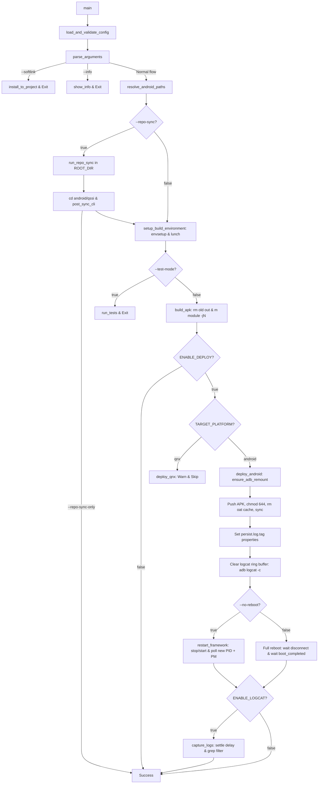

# build_apk.sh — AOSP System APK Build & Deployment Toolkit

An automated developer workflow script for building and deploying privileged system applications (`priv-app`) in **AOSP / Android Automotive** environments (Qualcomm QSSI architecture):

**lunch → build module → root & remount → push APK → reboot / fast restart → capture logcat**

| File | Purpose |
|---|---|
| `build_apk.sh` | Core execution script (orchestration logic, alias `telua`) |
| `apk.config` | Active project configuration (profile selection, lunch targets, deploy flags, debug tags) |
| `apk_overlays.config.example` | Template for personal/private project overrides (auto-applied by `telua init`) |
| `apk_overlays.config` | Local confidential project overrides (untracked in Git, preserved across updates) |
| `config_overlay.py` | Smart overlay merge engine (merges `apk_overlays.config` onto `apk.config`) |
| `config/const_car.config` | Global AAOS Car & Audio ADB key injection commands configuration |
| `config/const_dumpsys.config` | Global Dumpsys & AAOS diagnostics commands configuration |
| `config/const_multi_cli.config` | Global Multi-command sequential pipelines & macros with fail-fast safety |
| `config/const_my_cli.config.example` | Template for personal private pipelines & macros (`telua my <action>`) |
| `config/const_my_cli.config` | Personal private pipelines & macros (untracked in Git, preserved across updates) |
| `config/const_git.config` | Frequently used Git & Google Repo commands cheatsheet (`telua git`) |
| `config/const_docker.config` | Frequently used Docker daemon, container & image commands cheatsheet (`telua docker`) |
| `config/const_network.config` | Frequently used Network, Port & ADB over Wi-Fi commands cheatsheet (`telua network`) |
| `config_crypto.py` | Encrypt / decrypt `apk.config` with a password (PBKDF2 + Fernet) |
| `requirements.txt` | Python package dependencies for `config_crypto.py` (`cryptography`) |

---

## 1. Prerequisites

> [!IMPORTANT]
> **Linux Only:** AOSP compilation tools (`build/envsetup.sh`, `lunch`, Soong, Ninja, and `m`) are strictly designed for Linux environments (e.g., Ubuntu LTS). This script cannot run directly on Windows Command Prompt or PowerShell. If editing on Windows, ensure files maintain Linux (LF) line endings before pushing to your Linux build host.

- **Linux build host** with an initialized AOSP source tree adhering to `.../android/qssi/` (must contain `build/envsetup.sh`).
- **ADB** (`platform-tools`) installed and accessible in `$PATH`.
- **Target Device** running a **`userdebug`** or **`eng`** build image. Production `user` builds strictly disallow `adb root` and `adb remount` (script will safely abort).
- **Python 3** with `cryptography` package (automatically installed during `./build_apk.sh --install` via `requirements.txt`, or install manually):
  ```bash
  python3 -m pip install -r requirements.txt
  ```
- Exactly **one** ADB device/DUT connected.
- Execute permissions and Linux (LF) line endings:
  ```bash
  chmod +x build_apk.sh config_crypto.py config_overlay.py
  dos2unix build_apk.sh *.config config/*.config *.py *.example      # required if files were transferred from Windows
  git update-index --chmod=+x build_apk.sh config_crypto.py config_overlay.py # preserves 100755 in Git
  ```

---

## 2. Quick Start & CLI Installation

### Step 1: One-Time CLI Installation
Make the scripts executable and install the global `telua` alias into your `~/.bashrc` (this also automatically installs any required Python packages from `requirements.txt`):

```bash
# 1. Grant execution permissions
chmod +x build_apk.sh config_crypto.py config_overlay.py

# 2. Install 'telua' command into ~/.bashrc
./build_apk.sh --install
source ~/.bashrc
```

Now you can invoke `telua` anywhere in your terminal!
- Run `telua` with no arguments to display the interactive help menu.

### Step 2: Build & Deployment

Place `apk.config` (or run `telua init`) inside your project directory within the AOSP tree:

```bash
# 1. Select ACTIVE_PROJECT and verify your lunch target
nano apk.config

# 2. Inspect target, module paths, and connected device info
telua info

# 3. Build module, push to system partition, and reboot (or: telua b)
telua build

# Or fast deploy after editing Java/Kotlin source files (5-10s):
telua build --no-reboot
```

> **AOSP Discovery:** The script resolves the AOSP root by walking upwards from its directory until it finds an ancestor directory named `android`, setting `ANDROID_TOP=<...>/android/qssi`.

---

## 3. Multi-Workspace Architecture (`--softlink`)

Maintain **a single golden copy of `build_apk.sh`** shared across multiple independent AOSP checkouts, release branches, or workspaces. Each workspace maintains its own standalone `apk.config`.

```
~/code/telua_skill/.../build/           ← Master Repository (edit logic here)
├── build_apk.sh                        ← Master CLI engine & orchestration logic
├── apk.config                          ← Active configuration profile
├── apk_overlays.config.example         ← Personal override template (auto-copied by telua init)
├── config_overlay.py                   ← Smart overlay merge engine (merges overrides into apk.config)
├── config_crypto.py                    ← Configuration encryption utility (PBKDF2 + Fernet)
├── enc_apk.config                      ← Encrypted configuration template (Base64)
├── requirements.txt                    ← Python dependencies (cryptography)
├── AI.md                               ← AI Assistant & LLM instruction reference
└── config/                             ← Shared constants, macros & cheatsheets
    ├── const_car.config                ← AAOS car & audio key injections
    ├── const_dumpsys.config            ← System dumpsys diagnostics
    ├── const_multi_cli.config          ← Multi-command sequential pipelines
    ├── const_my_cli.config.example     ← Personal private pipeline macro template
    ├── const_docker.config             ← Docker & systemd cheatsheet
    ├── const_git.config                ← Git & Google Repo cheatsheet
    └── const_network.config            ← Network & Wi-Fi debugging cheatsheet

~/ws_main/android/qssi/tools/           ← Local Workspace (created via telua init / --softlink)
├── build_apk.sh  -> (symlink to master build_apk.sh)
├── apk.config        (ACTIVE_PROJECT="oem_service", target A)
├── apk_overlays.config (Local confidential overrides, git-ignored)
├── OemService.apk    (Build output artifact copied here)
└── deployment_log.txt
```

### Installing to a Workspace

You can either pass the target path directly via CLI, or configure `SOFTLINK_TARGET_PATH` inside `apk.config`:

```bash
# Option A: Specify destination directly
mkdir -p ~/ws_main/android/qssi/tools
./build_apk.sh --softlink ~/ws_main/android/qssi/tools

# Option B: Pre-configure SOFTLINK_TARGET_PATH="/home/user/ws_main/android/qssi/tools" in apk.config
./build_apk.sh --softlink
```

`--softlink [path]` automatically performs:
1. Validates that the target path is inside an AOSP tree (under an `android/` directory).
2. Automatically creates the destination directory (`mkdir -p`) if its parent directory exists.
3. Creates `<path>/build_apk.sh` as a **symbolic link** pointing to the canonical master script.
4. **Copies** `apk.config` adjacent to the calling script into `<path>/apk.config`.
5. Safely **overwrites** existing links and files if present.

### Working Inside Each Workspace

```bash
cd ~/ws_main/android/qssi/tools
nano apk.config          # configure ACTIVE_PROJECT="oem_service", target A
./build_apk.sh --info
./build_apk.sh

cd ~/ws_release/android/qssi/tools
nano apk.config          # configure ACTIVE_PROJECT="car_audio", target B
./build_apk.sh
```

### Why This Architecture Works
- **Centralized Logic Updates:** Fixes and enhancements made to master `build_apk.sh` propagate instantly to every linked workspace without manual syncing.
- **Isolated Per-Project Configs:** Each workspace independently manages its `ACTIVE_PROJECT`, lunch target, CPU threads, and debug tags.
- **Context-Aware Path Resolution:** The script detects the `android/` root relative to the **location of the symlink**, not the master script. Executing the link in `ws_main` builds `ws_main`.
- **Isolated Artifacts:** Generated APKs and `deployment_log.txt` are created locally inside the workspace tools directory.

### Important Caveats
- Re-running `--softlink` against an existing directory will **overwrite `apk.config`** in that directory. Back up any customized config beforehand.
- New variables added to the master `apk.config` will not automatically backport to existing copies. The script relies on defaults (`${VAR:-...}`), but manual addition is needed to customize new flags.
- Symlinks placed outside an `android/` directory tree will trigger a warning and will fail to resolve `ANDROID_TOP`.
- Do not run deployments concurrently from two workspaces targeting the same physical device.

---

## 4. Command Line Options

| Option / Subcommand | Description |
|---|---|
| *(none)*, `-h`, `--help`, `help` | Displays interactive help menu, subcommands, and configuration file paths |
| `build`, `b`, `--build` | Full cycle: Build module + Push APK (if `ENABLE_DEPLOY="true"`) + Full Device Reboot |
| `--no-reboot` | Fast runtime restart (`stop && start`, ~10–15s) instead of full device reboot |
| `--config <path>` | Explicitly specifies path to `apk.config` to load |
| `--init`, `init` | Initializes `apk.config` in current directory (`$PWD`), auto-creates missing personal configs from `*.example`, enforces script permissions, and merges `apk_overlays.config` via `config_overlay.py` |
| `--install`, `install` | Adds or updates alias `telua` in `~/.bashrc` pointing to `build_apk.sh`, and sources `~/.bashrc` |
| `-v`, `--version`, `version` | Displays script version, release update date, and exits |
| `--info`, `info` | Displays general build configuration followed by platform-specific target info (Android / QNX), then exits |
| `--platform android\|qnx` | Target deployment platform: `android` (default, active) or `qnx` (reserved, currently skips deployment) |
| `--start-deploy true\|false` | Overrides `ENABLE_DEPLOY` defined in `apk.config` |
| `--softlink [path]` | Creates symlink to `build_apk.sh` and copies `apk.config` to `[path]` (falls back to `SOFTLINK_TARGET_PATH` from `apk.config` if omitted) |
| `--repo-sync` | Executes `repo sync` from `ROOT_DIR`, navigates to `android/qssi`, and runs `post_sync_cli` before building |
| `--repo-sync-only` | Executes `repo sync` and `post_sync_cli` only, then exits without building |
| `--repo-reset` | Executes `repo forall -c "git reset --hard && git clean -xdf"` (requires interactive `y` confirmation; bypass with `-y`) |
| `-y`, `--yes` | Bypasses interactive confirmation prompts for dangerous operations (e.g., `--repo-reset`) |
| `--git-diff` | Displays `git diff HEAD^ HEAD` in the script's git repository and exits |
| `--git-amend` | Runs `git commit --amend --no-edit` (staged changes only) and exits |
| `--update`, `update` | Updates this toolkit repository via `git pull origin main` (auto-backs up & restores personal configs, auto-recovers hard reset on conflict) |
| `--git-help`, `git` | Displays cheatsheet of commonly used Git commands and exits |
| `--docker-help`, `docker` | Displays cheatsheet of commonly used Docker commands and exits |
| `--network-help`, `network` | Displays cheatsheet of commonly used Network & Port commands and exits |
| `car [action]`, `audio [action]` | Controls car/audio via ADB shell (`vol-up`, `vol-down`, `vol-mute`, `ks`, `ks-stop`, `car-status`) using commands from `config/const_car.config` |
| `--dump`, `dump [target]` | Runs dumpsys diagnostics via ADB shell (`audio`, `car-service`, `car-audio`, `media`, `battery`, `activity`) using commands from `config/const_dumpsys.config` |
| `--run`, `run [group]` | Executes multi-command sequential pipeline group from `config/const_multi_cli.config` (alias: `telua multi [group]`) |
| `my [action]`, `proj [action]` | Executes personal private pipeline macro from `config/const_my_cli.config` (`telua my hello`) |
| `--find-file <pattern> [path]` | Searches for files by pattern in `[path]` (defaults to `.` if omitted) |
| `--find-dir <pattern> [path]` | Searches for directories by pattern in `[path]` (defaults to `.` if omitted) |
| `--find-text <text> [path]` | Greps for text string in files under `[path]` (defaults to `.` if omitted) |
| `--test-mode true|false` | Runs unit test suite instead of compiling the APK |

#### Usage Examples:
```bash
telua                                 # View interactive help menu & available subcommands
telua build                           # Build active module, push APK, and reboot device
telua build --no-reboot               # Fast deploy after editing Java/Kotlin code (~5-10s)
telua b                               # Short alias for 'telua build'
./build_apk.sh --install              # Install/update 'telua' alias in ~/.bashrc
telua init                            # Initialize workspace & apply apk_overlays.config
telua info                            # Inspect environment and device state
telua update                          # Update toolkit: pulls origin/main & preserves personal configs
telua car vol-up                      # Increase volume (AAOS inject-key 24) (or: telua audio vol-up)
telua car vol-down                    # Decrease volume (AAOS inject-key 25)
telua car vol-mute                    # Mute volume (AAOS inject-key 164)
telua car ks                          # Start KitchenSink test app (or: telua audio ks)
telua car ks-stop                     # Force stop KitchenSink test app
telua dump audio                      # Dump audio service status (or: telua --dump audio)
telua dump car-service                # Dump AAOS CarService state
telua dump car-audio                  # Dump AAOS CarAudioService
telua run                             # View all pipeline macro groups and steps (or: telua multi)
telua run audio-cycle                 # Run KitchenSink restart & volume test pipeline
telua run dev-prep                    # Run device prep pipeline (root, remount, debug tags)
telua my hello                        # Run personal private macro from config/const_my_cli.config
telua git                             # View Git cheatsheet (or: telua --git-help)
telua docker                          # View Docker daemon & container cheatsheet
telua network                         # View Network & Port cheatsheet
./build_apk.sh --find-file "*.bp" packages/apps/Car # Find Android.bp files in specific path
./build_apk.sh --find-dir "Oem*" .    # Find directories matching pattern
./build_apk.sh --find-text "DEBUG_TAG" src/ # Grep text string inside files
./build_apk.sh --git-diff             # View diff of the last commit
./build_apk.sh --git-amend            # Amend staged changes to the last commit
./build_apk.sh --start-deploy false   # Compile APK only, do not push to device
./build_apk.sh --no-reboot            # Fast deploy after editing Java source files
./build_apk.sh --repo-sync            # Sync repo from ROOT_DIR, then build and deploy
./build_apk.sh --repo-sync --repo-reset # Hard reset all repos, then sync and build
./build_apk.sh --repo-sync-only       # Sync repo and execute post_sync_cli hook only
./build_apk.sh --test-mode true       # Execute project test runner
```

> **When to avoid `--no-reboot`:** Perform a full device reboot if you modified `AndroidManifest.xml` (permissions, exported components, new services), SELinux `.te` policies, or added a brand new system app.

---

## 5. Configuration Reference (`apk.config`)

### 5.1 Project Profiles (`ACTIVE_PROJECT`)

```bash
ACTIVE_PROJECT="oem_service"   # "oem_service" | "car_audio" | "vehicle_service"
```

Each profile case defines the module parameters:

| Variable | Description |
|---|---|
| `MODULE_NAME` | AOSP compilation module identifier passed to `m <MODULE_NAME>`. Corresponds to `name:` in `Android.bp` or `LOCAL_PACKAGE_NAME` in `Android.mk`. If omitted, defaults to `${APK_FILE_NAME%.apk}` |
| `SOURCE_CODE_RELATIVE_PATH` | Path to module source directory relative to `ANDROID_TOP` (see details below) |
| `APK_OUTPUT_RELATIVE_PATH` | Target output directory relative to `ANDROID_TOP` (**cleaned before each build**) |
| `APK_FILE_NAME` | Expected output binary filename (e.g., `OemService.apk`) |
| `APK_DEPLOY_PATH` | Destination system directory on target device (e.g., `/system/priv-app/OemService`) |
| `DEFAULT_LOGCAT_FILTER` | Default regex filter for logcat capture |
| `DEFAULT_DEBUG_LOG_TAGS` | Default log tags to enable at `DEBUG` level for this service |

#### 💡 Source Code Directory Note (`SOURCE_CODE_RELATIVE_PATH`):
The directory specified by `SOURCE_CODE_RELATIVE_PATH` must contain the build and manifest definition files:
* **`Android.bp` (Soong build system):**
  Defines the module via `android_app { name: "OemService", srcs: [...], privileged: true }`. The `name` attribute is your `MODULE_NAME`.
* **`Android.mk` (GNU Make system):**
  Defines `LOCAL_PACKAGE_NAME := OemService` or `LOCAL_MODULE := OemService`.
* **`AndroidManifest.xml`:**
  Defines package name, shared user IDs (`android:sharedUserId="android.uid.system"`), system permissions, and services. Changes here require a full device reboot.

*To add a new service profile:* Copy an existing `"..." ) ... ;;` case block, update the paths, and set `ACTIVE_PROJECT` to your new profile name.

### 5.1b Softlink Target Workspace

| Variable | Default | Description |
|---|---|---|
| `SOFTLINK_TARGET_PATH` | `""` | Default workspace destination when running `./build_apk.sh --softlink` without specifying `<project_path>` via CLI |

---

### 5.2 Build Environment

| Variable | Description |
|---|---|
| `TARGET_PLATFORM` | Target deployment platform: `"android"` (default, fully supported via ADB) or `"qnx"` (reserved for QNX Hypervisor, skips direct deploy) |
| `AOSP_TOP_REL_PATH` | Relative path to AOSP build root from `ROOT_DIR`. Examples: `"android/qssi"` (Qualcomm QSSI) or `"android"` (MediaTek / NXP / pure AOSP / QNX Android container). Defaults to auto-detecting `android/qssi` if present, otherwise `android`. |
| `CONFIG_TARGET_PRODUCT` | Target product for `lunch` (e.g., `abc_xyz_in`) |
| `CONFIG_TARGET_BUILD_VARIANT` | Target build variant (`userdebug` or `eng`) |
| `ENV_VAR_PRODUCT_NAME` | Name of environment variable exported by `lunch` for target product (default: `"TARGET_PRODUCT"`). Customizable for vendor BSPs |
| `ENV_VAR_VARIANT_NAME` | Name of environment variable exported by `lunch` for target build variant (default: `"TARGET_BUILD_VARIANT"`). Customizable for vendor BSPs |
| `BUILD_JOBS` | Parallel compilation threads (`-j`). Leave empty `""` to auto-detect via `nproc` (fallback: 8) |

> **Active Shell Optimization:** If the current terminal session already has an active environment (variables defined by `ENV_VAR_PRODUCT_NAME` and `ENV_VAR_VARIANT_NAME` are set), the script **skips `envsetup.sh` and `lunch`** to save execution time.

### 5.2b Repo Sync & Two-Stage Post-Sync CLI Hooks

All repo-related options are explicitly prefixed with `REPO_` to clearly distinguish them from the single-module APK build configuration:

| Variable | Default | Description |
|---|---|---|
| `REPO_SYNC_JOBS` | `"4"` | Number of parallel jobs for `repo sync` (`-j4`) |
| `REPO_SYNC_FLAGS` | `"-d -c --force-sync --no-clone-bundle --tags"` | Complete clean flags passed to `repo sync` |
| `REPO_ENABLE_RESET` | `"false"` | Runs `repo forall -c "git reset --hard && git clean -xdf"` before sync (can also trigger via `--repo-reset`) |
| `REPO_POST_SYNC_ROOT_COMMAND` | `""` | CLI command executed in `ROOT_DIR` right after repo sync (**BEFORE** `cd android/qssi`, e.g., BSP setup, vendor scripts) |
| `REPO_POST_SYNC_BUILD_COMMAND` | `""` | CLI command executed in `ANDROID_TOP` (**AFTER** entering `android/qssi`, e.g., full project rebuild `m -j16`) |

---

### 5.3 Device Deployment & Diagnostics (Android / ADB)

| Variable | Default | Description |
|---|---|---|
| `ENABLE_ANDROID_DEPLOY` | `"true"` | Enables or disables pushing APK to connected Android device (also supports legacy `ENABLE_DEPLOY`) |
| `ENABLE_DEBUG_LOG` | `"true"` | Automatically sets debug log properties on the device |
| `DEBUG_LOG_LEVEL` | `"DEBUG"` | Target logging level (`DEBUG` or `VERBOSE`) |
| `DEBUG_LOG_TAGS` | profile default | Space-separated log tags (e.g., `"CarAudioService CarZones"`) |
| `ENABLE_ANDROID_LOGCAT` | `"false"` | Captures post-deployment logcat to file (also supports legacy `ENABLE_LOGCAT`) |
| `LOGCAT_FILTER` | profile default | Regex filter for `adb logcat -d \| grep -E` |
| `LOGCAT_SETTLE_SECONDS` | `"10"` | Seconds to wait after restart before dumping logcat buffer |

Debug tags are activated via persistent system properties:
```bash
adb shell setprop persist.log.tag.<TAG> DEBUG
```
This ensures `Log.isLoggable(TAG, Log.DEBUG)` returns `true` in Java code and persists across reboots.

---

### 5.3b AAOS Car & Audio Control (`config/const_car.config`)

Các lệnh ADB điều khiển âm lượng và ứng dụng test âm thanh (KitchenSink) được quản lý tập trung trong file cố định **`config/const_car.config`** (nằm trong thư mục `config/` của toolkit gốc), gọi qua `telua car [action]` hoặc `telua audio [action]`:

| Variable | Default | Description |
|---|---|---|
| `ADB_SHELL_AUDIO_UP` | `"dumpsys car_service inject-key 24"` | Command executed for `vol-up` (AAOS CarInputService inject key 24) |
| `ADB_SHELL_AUDIO_DOWN` | `"dumpsys car_service inject-key 25"` | Command executed for `vol-down` (AAOS CarInputService inject key 25) |
| `ADB_SHELL_AUDIO_MUTE` | `"dumpsys car_service inject-key 164"` | Command executed for `vol-mute` (AAOS CarInputService inject key 164) |
| `ADB_SHELL_AUDIO_KS_START` | `"am start com.google.android.car.kitchensink/.KitchenSinkActivity"` | Launch KitchenSink test app |
| `ADB_SHELL_AUDIO_KS_STOP` | `"am force-stop com.google.android.car.kitchensink"` | Force-stop KitchenSink test app |
| `AUDIO_CLI_LIST` | Mảng 5 lệnh CLI (`vol-up`, `vol-down`, `vol-mute`, `ks`, `ks-stop`) | Danh sách lệnh hiển thị cho người dùng khi chạy `telua car` hoặc `telua audio` |

> **Ghi chú về tách biệt cấu hình:**
> - `config/const_car.config` giữ các giá trị mặc định dùng chung cho mọi dự án.
> - Nếu một dự án cụ thể cần tùy biến riêng câu lệnh âm thanh, bạn có thể khai báo đè (override) trực tiếp các biến này trong file `apk.config` hoặc `apk_overlays.config`.

---

### 5.3c Dumpsys & Diagnostics (`config/const_dumpsys.config`)

Các lệnh ADB dumpsys chẩn đoán hệ thống được quản lý tập trung trong file cố định **`config/const_dumpsys.config`** (gọi qua `telua dump <target>` hoặc `telua --dump <target>`):

| Variable | Default | Description |
|---|---|---|
| `ADB_SHELL_DUMP_AUDIO` | `"dumpsys audio"` | Command for `telua dump audio` (standard AudioService) |
| `ADB_SHELL_DUMP_CAR_SERVICE` | `"dumpsys car_service"` | Command for `telua dump car-service` (AAOS CarService) |
| `ADB_SHELL_DUMP_CAR_AUDIO` | `"dumpsys car_audio"` | Command for `telua dump car-audio` (AAOS CarAudioService) |
| `ADB_SHELL_DUMP_MEDIA_SESSION` | `"dumpsys media_session"` | Command for `telua dump media` |
| `ADB_SHELL_DUMP_BATTERY` | `"dumpsys battery"` | Command for `telua dump battery` |
| `ADB_SHELL_DUMP_ACTIVITY` | `"dumpsys activity top"` | Command for `telua dump activity` |
| `DUMP_CLI_LIST` | Mảng 6 mục chẩn đoán | Danh sách mục dumpsys hiển thị khi chạy `telua dump` |

---

### 5.3d Multi-Command Sequential Pipelines (`config/const_multi_cli.config`)

Các quy trình chạy tuần tự nhiều bước (pipeline / macro) được cấu hình tập trung trong **`config/const_multi_cli.config`** (gọi qua `telua run <group>` hoặc `telua multi <group>`):

| Variable / Group | Commands in Pipeline | Purpose |
|---|---|---|
| `MULTI_CMD_AUDIO_CYCLE` | `am force-stop` $\rightarrow$ `sleep` $\rightarrow$ `am start` $\rightarrow$ `inject-key 24/25` | Chu trình khởi động KitchenSink và test phím volume |
| `MULTI_CMD_DEV_PREP` | `adb root` $\rightarrow$ `adb remount` $\rightarrow$ `setprop persist.log.tag.* DEBUG` | Chuẩn bị quyền root, remount và bật log debug CarAudio |
| `MULTI_CMD_REMOUNT_REBOOT` | `adb root` $\rightarrow$ `adb remount` $\rightarrow$ `adb reboot` | Root, remount phân vùng hệ thống và khởi động lại thiết bị |
| `MULTI_CMD_AUDIO_DUMP` | `dumpsys audio` $\rightarrow$ `dumpsys car_audio` $\rightarrow$ `dumpsys media_session` | Thu thập chẩn đoán toàn diện âm thanh hệ thống |
| `MULTI_CMD_LOGCAT_START` | `wait-for-device` $\rightarrow$ `kill old pid` $\rightarrow$ `logcat -c` $\rightarrow$ `nohup adb logcat ... &` | Đợi thiết bị, dọn tiến trình cũ, xóa buffer & ghi logcat mới ra file |
| `MULTI_CMD_LOGCAT_STOP` | `kill $(cat .logcat.pid) \|\| pkill adb logcat` $\rightarrow$ `ls -lh device_logcat.log` | Dừng tiến trình logcat trên máy tính và hiển thị kích thước file log |
| `MULTI_GROUP_LIST` | Danh sách đăng ký các nhóm | Hiển thị bảng tra cứu khi chạy `telua run` |

> **Cơ chế Fail-Fast:** Nếu bất kỳ bước nào trong pipeline trả về mã lỗi (`exit code != 0`), kịch bản sẽ lập tức dừng lại và thông báo chính xác bước thất bại, bảo vệ an toàn cho thiết bị.

---

### 5.3e Personal Pipelines (`config/const_my_cli.config`)

Các quy trình chạy tuần tự riêng tư của cá nhân Developer được cấu hình trong **`config/const_my_cli.config`** (gọi qua `telua my <action>` hoặc alias `telua proj <action>`):

| Variable / Action | Commands in Pipeline | Purpose |
|---|---|---|
| `MY_CMD_HELLO` | `echo "Hello World"` $\rightarrow$ `sleep 1` | Ví dụ mẫu in Hello World và sleep 1s |
| `MY_GROUP_LIST` | Danh sách đăng ký các action cá nhân | Hiển thị bảng tra cứu khi chạy `telua my` |

---

### 5.4 Unit Tests

| Variable | Description |
|---|---|
| `TEST_RELATIVE_PATH` | Path to test suite directory relative to script directory |
| `TEST_BUILD_SCRIPT` | Executable test runner script (e.g., `run_unittest_test.sh`) |

---

### 5.4b QNX Target Configuration (Reserved for Future Use)

Placeholder variables reserved in `apk.config` for future QNX Hypervisor / Guest VM deployment workflows:

| Variable | Default | Description |
|---|---|---|
| `ENABLE_QNX_DEPLOY` | `"false"` | Enables or disables deploying to QNX target environment (reserved, default: false) |
| `ENABLE_QNX_LOG` | `"false"` | Enables or disables capturing slog2 logs on QNX target (reserved, default: false) |
| `QNX_HOST_IP` | `"192.168.1.100"` | QNX Target Hostname or IP address |
| `QNX_SSH_PORT` | `"22"` | Target SSH / SCP communication port |
| `QNX_TARGET_DIR` | `"/var/opt/apps"` | Destination filesystem directory on QNX target |

---

### 5.5 Configuration Encryption & Security (`config_crypto.py`)

Encrypt or decrypt `apk.config` to protect internal targets, paths, and sensitive settings before committing or transferring files.

* **Cryptographic Scheme**: PBKDF2-HMAC-SHA256 (600,000 iterations) with a 16-byte random salt to derive a 256-bit key for [Fernet](https://cryptography.io/en/latest/fernet/) (AES-128-CBC + HMAC-SHA256).
* **Format**: Base64 text `base64(salt(16 bytes) || Fernet token)`, safe for version control or text exchange.
* **File Permissions**: Output files are created with restricted permissions (`0600` / owner read-write only).
* **Safety Guardrails**: Decryption outputs to `dec_apk.config` by default to avoid accidentally overwriting the active `apk.config`. Overwriting requires `--force`.

#### Commands & Usage:

```bash
# 1. Encrypt apk.config -> enc_apk.config (interactive hidden prompt: use '?' or omit)
./config_crypto.py encrypt ?
./config_crypto.py encrypt

# Or provide password directly via command line (NOTE: visible in shell history/ps):
./config_crypto.py encrypt 12345

# Or pipe password via stdin:
echo "12345" | ./config_crypto.py encrypt -

# 2. Decrypt enc_apk.config -> dec_apk.config (original apk.config is never touched)
./config_crypto.py decrypt ?
./config_crypto.py decrypt

# Or with password directly:
./config_crypto.py decrypt 12345

# 3. Overwrite an existing dec_apk.config:
./config_crypto.py decrypt ? --force
./config_crypto.py decrypt 12345 --force

# 4. Custom input and output paths:
./config_crypto.py encrypt ? -i my.config -o my_enc.config
./config_crypto.py decrypt ? -i my_enc.config -o my_dec.config --force
```

| Action | Default Input | Default Output | Behavior |
|---|---|---|---|
| `encrypt` | `apk.config` | `enc_apk.config` | Overwrites existing output file automatically |
| `decrypt` | `enc_apk.config` | `dec_apk.config` | Preserves existing file; requires `--force` to overwrite |

---

### 5.5 Personal Overrides & Smart Merge (`apk_overlays.config` & `config_overlay.py`)

Bộ công cụ hỗ trợ cơ chế nạp đè cấu hình cá nhân (**Personal & Private Overrides**) nhằm tách biệt hoàn toàn giữa cấu hình chuẩn của kho mã nguồn chung và các thông số riêng tư của từng lập trình viên/dự án mật:

* **File cấu hình cá nhân:** `apk_overlays.config` (được tạo tự động từ `apk_overlays.config.example` khi chạy `telua init` nếu chưa có).
* **Bảo mật tuyệt đối (Zero Git Leak):** `apk_overlays.config` được đưa vào `.gitignore`, ngăn chặn triệt để nguy cơ commit nhầm đường dẫn nội bộ, key bí mật hay profile dự án riêng lên GitHub.
* **Quy tắc Smart Merge (`config_overlay.py`):**
  1. **Top-level variables:** Các biến ngoài cùng (`ACTIVE_PROJECT`, `BUILD_JOBS`, `CONFIG_TARGET_PRODUCT`, ...) được thay thế chính xác tại chỗ (in-place replacement) trong `apk.config`.
  2. **Case branch merge:** Các nhánh profile trong khối `case "$ACTIVE_PROJECT" in` (ví dụ `"oem_service")`) được thay thế theo từng nhánh độc lập. Các nhánh khác (`car_audio`, `vehicle_service`) hoàn toàn không bị ảnh hưởng.
  3. **Custom profile addition:** Nếu bạn khai báo một profile mới (ví dụ `"my_custom_service")`), engine sẽ tự động chèn nhánh mới ngay trước nhánh mặc định `*)`.
  4. **Multi-command macros:** Hỗ trợ mảng nhiều dòng (như `MULTI_CMD_CUSTOM_SETUP=(...)`).

```bash
# Kiểm tra thử kết quả merge mà không làm thay đổi file (Dry-run mode):
python3 config_overlay.py ./apk.config --dry-run
```

---

### 5.6 Toolkit Auto-Update (`telua update` / `--update`)

Tự động cập nhật kho lưu trữ master của bộ công cụ `telua` lên commit mới nhất từ nhánh `origin/main` với cơ chế bảo vệ file cá nhân toàn diện:

```bash
telua update
# Hoặc:
./build_apk.sh --update
```

* **Bảo vệ cấu hình cá nhân (Personal Configs Protection):**
  1. Trước khi thực hiện `git pull`, script tự động sao lưu an toàn các file cá nhân (`apk_overlays.config` và `config/const_my_cli.config`) vào thư mục tạm `/tmp/`.
  2. Tiến hành kéo mã nguồn từ `origin/main`.
  3. **Tự phục hồi xung đột (Self-Healing / Auto-Recovery):** Nếu phát hiện merge conflict hoặc tree bị dirty, kịch bản tự kích hoạt `git fetch origin main` và `git reset --hard origin/main`.
  4. Sau khi cập nhật xong, các file cá nhân được **tự động phục hồi nguyên vẹn** từ bản sao lưu tạm, đảm bảo không bao giờ bị mất cấu hình riêng khi update.
  5. Tự động kiểm tra và khôi phục quyền thực thi (`chmod +x`) cho tất cả các script trong bộ công cụ.

---

## 6. Execution Lifecycle

When executed, `build_apk.sh` follows this strict sequential pipeline:



1. **Config Validation:** Loads `apk.config` and verifies presence of all mandatory parameters.
2. **AOSP Path Discovery:** Resolves `ROOT_DIR` and `ANDROID_TOP` (`.../android/qssi`).
3. **Repo Sync (Optional via `--repo-sync`):** Navigates to `ROOT_DIR`, runs `repo sync` with timing benchmarks, switches into `$ANDROID_TOP`, and executes `post_sync_cli` hook.
4. **Environment Setup:** Sources `build/envsetup.sh` and invokes `lunch` target.
5. **Module Compilation:** Cleans stale artifacts in `$DIR_OUT` and compiles specific target: `m "$MODULE_NAME" -j"$BUILD_JOBS"`. Copies the output APK to the local script folder.
6. **Remount & Verification:** Acquires root (`id -u == 0`), runs `adb remount`, and performs an active write probe (`touch .build_apk_rw_test`). Automatically manages overlayfs/scratch initial reboot cycles if detected.
7. **Payload Push:** Transfers APK to `$APK_DEPLOY_PATH`, enforces `chmod 644`, wipes obsolete Dalvik/ART cache (`rm -rf oat/`), and invokes `sync`.
8. **Property Configuration:** Injects `persist.log.tag.<TAG>` settings for all configured tags.
9. **Buffer Reset:** Executes `adb logcat -c` to flush historical log buffer.
10. **Reboot / Restart:**
   - *Default:* Reboots device, waits for disconnect, waits for device reconnect, and blocks until `sys.boot_completed=1`.
   - *Fast Mode (`--no-reboot`):* Invokes `stop && start`, blocks until `system_server` acquires a new PID and `pm path android` answers.
11. **Log Diagnostics:** Sleeps `LOGCAT_SETTLE_SECONDS`, dumps `adb logcat -d`, filters lines via regex, and saves to `deployment_log.txt`.

---

## 7. Troubleshooting Guide

| Issue / Error | Root Cause & Resolution |
|---|---|
| `Could not find the 'android' root directory` | Script or symlink is outside an `android/` source tree. Verify location or inspect with `./build_apk.sh --info`. |
| `Cannot find 'build/envsetup.sh'` | CWD does not match expected Qualcomm `android/qssi` tree. Check ancestor paths. |
| `Failed to initialize target environment variables after lunch` | Invalid `CONFIG_TARGET_PRODUCT` or `CONFIG_TARGET_BUILD_VARIANT`. Ensure lunch target exists in lunch menu. |
| `APK not found ... after build completed` | Mismatch between `MODULE_NAME` and `Android.bp` `name:`. Verify module name via `grep 'name:' Android.bp`. |
| `Device is running a 'user' build! 'adb remount' is forbidden` | Target hardware has a secure production build. Flash a `userdebug` or `eng` flash image. |
| `adbd is not running as root after 30s` | Device build restricts root or ADB daemon hung. Execute `adb kill-server && adb root` manually. |
| `... is still read-only after 'adb remount'` | DM-verity enabled on partition. Run `adb disable-verity && adb reboot`, then re-run script. |
| `error: more than one device/emulator` | Multiple devices/emulators connected. Disconnect secondary devices; script expects a single DUT. |
| `Fast restart failed ... did not come back` | System service crashed on startup or failed to restart. Re-run without `--no-reboot` to trigger clean boot. |
| `Captured log is empty` | Application didn't start within timeout or regex filter mismatched. Increase `LOGCAT_SETTLE_SECONDS` or broaden `LOGCAT_FILTER`. |
| Newly pushed code changes not executing | Code change involves manifest, permissions, or system signatures requiring full reboot. Remove `--no-reboot`. |
| `/bin/bash^M: bad interpreter` | Windows CRLF line endings present. Run `dos2unix build_apk.sh apk.config`. |

---

## 8. Community & Contributing

Contributions from the developer community are welcome! Whether you are adding new automotive shortcuts, improving diagnostic dumps, or hardening build orchestration, please read our contribution guide:

👉 **[Contribution Guidelines & Workflow](CONTRIBUTING.md)**

### Quick Guidelines:
* **Zero Cognitive Load:** Ensure interactive help and self-documenting cheatsheets exist for all CLI additions.
* **Enterprise Safety:** Require `[y/N]` interactive confirmation for any destructive actions.
* **Separation of Concerns:** Keep core logic in `build_apk.sh`, declarative commands in `const_*.config`, and project specifics in `apk.config`.
* **Line Endings:** Enforce Linux `LF` line endings (`dos2unix`).
* **Universal Language:** All code comments, help strings, and documentation must be written in professional English.

---

## 9. AI Agent & LLM Integration (`AI.md`)

Working with AI coding assistants (e.g., Gemini, Claude, Cursor, Copilot, Antigravity)?
Refer to our dedicated LLM reference guide:

👉 **[AI Agent & LLM Reference (AI.md)](AI.md)**

* Machine-readable intent-to-command mapping.
* Non-interactive execution rules (e.g. `-y` flag usage).
* Fast diagnostic & code inspection shortcuts for AI subagents.


