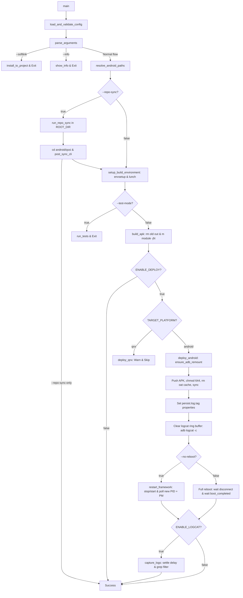

# build_apk.sh — AOSP System APK Build & Deployment Toolkit

An automated developer workflow script for building and deploying privileged system applications (`priv-app`) in **AOSP / Android Automotive** environments (Qualcomm QSSI architecture):

**lunch → build module → root & remount → push APK → reboot / fast restart → capture logcat**

| File | Purpose |
|---|---|
| `build_apk.sh` | Core execution script (orchestration logic, aliases `telua` & `tel`) |
| `config/apk.config` | Active project configuration (profile selection, lunch targets, deploy flags, debug tags) |
| `config/overlay/apk_overlays.config.example` | Template for personal/private project overrides (auto-copied by `tel init`) |
| `config/overlay/apk_overlays.config` | Local confidential project overrides (untracked in Git, preserved across updates) |
| `config/overlay/const_my_cli.config.example` | Template for personal private pipelines & macros (`tel my <action>`) |
| `config/overlay/const_my_cli.config` | Personal private pipelines & macros (untracked in Git, preserved across updates) |
| `python/config_overlay.py` | Smart overlay merge engine (merges `config/overlay/apk_overlays.config` onto `apk.config`) |
| `python/config_crypto.py` | Encrypt / decrypt private overlay configs (`apk_overlays.config`, `const_my_cli.config`) via PBKDF2 + Fernet (`tel crypto`, `tel enc`, `tel dec`) |
| `config/const_car.config` | Global AAOS Car & Audio ADB key injection commands configuration (`tel car`) |
| `config/const_dumpsys.config` | Global Dumpsys & AAOS diagnostics commands configuration (`tel dump`) |
| `config/const_security.config` | Global Security, SELinux & permissions diagnostics configuration (`tel sec`) |
| `config/const_multi_cli.config` | Global Multi-command sequential pipelines & macros with fail-fast safety (`tel run`) |
| `config/const_git.config` | Frequently used Git & Google Repo commands cheatsheet (`tel git`) |
| `config/const_docker.config` | Frequently used Docker daemon, container & image commands cheatsheet (`tel docker`) |
| `config/const_network.config` | Frequently used Network, Port & ADB over Wi-Fi commands cheatsheet (`tel network`) |
| `config/const_clean_java.config` | Configuration for `clean_java.py` and `google-java-format` checks |
| `src/telua_clean.sh` | Java source code hygiene, style auto-fixer, static report & AI skill linker (`tel java`) |
| `python/clean_java.py` | Enforces Java whitespace, tab expansion, keyword spacing, K&R braces & Google Java Style |
| `python/unused_methods_report.py` | 6-in-1 static Java report: unused methods, unused params, whitespace, `google-java-format`, unused imports & unused private fields (`tel java report`) |
| `src/telua_web.sh` & `web/telua_web.py` | Config Manager Web UI (Flask backend + vanilla JS frontend, `tel web start`) |
| `src/telua_docs.sh` & `sphinx/` | Sphinx Doc-as-Code manager with 4 project templates & live preview (`tel docs`) |
| `src/telua_completion.sh` | Bash and Zsh Tab Auto-completion engine with auto-reload (`tel <Tab><Tab>`) |
| `requirements.txt` | Python package dependencies (`cryptography`, `flask`, `sphinx`) |

---

## 1. Prerequisites

> [!IMPORTANT]
> **Linux Only:** AOSP compilation tools (`build/envsetup.sh`, `lunch`, Soong, Ninja, and `m`) are strictly designed for Linux environments (e.g., Ubuntu LTS). This script cannot run directly on Windows Command Prompt or PowerShell. If editing on Windows, ensure files maintain Linux (LF) line endings before pushing to your Linux build host.

- **Linux build host** with an initialized AOSP source tree adhering to `.../android/qssi/` (must contain `build/envsetup.sh`).
- **ADB** (`platform-tools`) installed and accessible in `$PATH`.
- **Target Device** running a **`userdebug`** or **`eng`** build image. Production `user` builds strictly disallow `adb root` and `adb remount` (script will safely abort).
- **Python 3** with `cryptography` package (automatically installed during `./build_apk.sh --install` via `requirements.txt`, or install manually):
  ```bash
  python3 -m pip install -r requirements.txt
  ```
- Exactly **one** ADB device/DUT connected.
- Execute permissions and Linux (LF) line endings:
  ```bash
  chmod +x build_apk.sh src/*.sh python/*.py
  dos2unix build_apk.sh src/*.sh config/*.config config/overlay/*.example python/*.py  # required if files were transferred from Windows
  git update-index --chmod=+x build_apk.sh python/config_crypto.py python/config_overlay.py # preserves 100755 in Git
  ```

---

## 2. Quick Start & CLI Installation

### Step 1: One-Time CLI Installation
Make the scripts executable and install the global `telua` & `tel` aliases into your `~/.bashrc` (this also automatically installs required Python packages from `requirements.txt`):

```bash
# 1. Grant execution permissions
chmod +x build_apk.sh src/*.sh python/*.py

# 2. Install 'telua' & 'tel' commands and Tab Auto-completion into ~/.bashrc
./build_apk.sh --install

# 3. Open a new terminal tab (recommended), or reload current session:
source ~/.bashrc
```

Now you can invoke `telua` (or short alias `tel`) anywhere in your terminal!
- **Tab Auto-completion**: Type `tel ` or `telua ` then press <kbd>Tab</kbd> twice to see available subcommands and options (`build`, `car`, `dump`, `run`, `replace`, etc.). Subcommands like `car` and `dump` also auto-complete their respective actions (e.g. `tel car ks<Tab>`).
- Run `telua` with no arguments to display the interactive help menu.

### Step 2: Build & Deployment

Place `apk.config` (or run `telua init`) inside your project directory within the AOSP tree:

```bash
# 1. Select ACTIVE_PROJECT and verify your lunch target
nano apk.config

# 2. Inspect target, module paths, and connected device info
telua info

# 3. Build module, push to system partition, and reboot (or: telua b)
telua build

# Or fast deploy after editing Java/Kotlin source files (5-10s):
telua build --no-reboot
```

> **AOSP Discovery:** The script resolves the AOSP root by walking upwards from its directory until it finds an ancestor directory named `android`, setting `ANDROID_TOP=<...>/android/qssi`.

---

## 3. Multi-Workspace Architecture (`--softlink`)

Maintain **a single golden copy of `build_apk.sh`** shared across multiple independent AOSP checkouts, release branches, or workspaces. Each workspace maintains its own standalone `apk.config`.

```
~/code/telua_aosp/                      ← Master Repository (edit logic here)
├── build_apk.sh                        ← Master CLI engine & orchestration logic (aliases: telua, tel)
├── src/                                ← 19 modular Bash domain scripts (telua_android.sh, telua_car.sh, ...)
├── python/                             ← Python automation & static analysis scripts
│   ├── clean_java.py                   ← Google/AOSP Java Style auto-fixer
│   ├── unused_methods_report.py        ← 6-in-1 static Java analyzer
│   ├── config_overlay.py               ← Smart overlay merge engine (merges overrides into apk.config)
│   └── config_crypto.py                ← Private overlay encryption utility (PBKDF2 + Fernet AES)
├── web/                                ← Config Manager Web UI (telua_web.py + static/)
├── sphinx/                             ← Sphinx Doc-as-Code templates & build scripts
├── requirements.txt                    ← Python dependencies
├── AI.md                               ← AI Assistant & LLM instruction reference
└── config/                             ← Shared constants, project configs, macros & cheatsheets
    ├── apk.config                      ← Master active configuration profile
    ├── const_car.config                ← AAOS car & audio key injections
    ├── const_dumpsys.config            ← System dumpsys diagnostics
    ├── const_security.config           ← SELinux & security diagnostics
    ├── const_clean_java.config         ← Java cleaner & google-java-format settings
    ├── const_multi_cli.config          ← Multi-command sequential pipelines
    ├── const_docker.config             ← Docker & systemd cheatsheet
    ├── const_git.config                ← Git & Google Repo cheatsheet
    ├── const_network.config            ← Network & Wi-Fi debugging cheatsheet
    └── overlay/                        ← Personal / private configs (git-ignored plaintext, AES-encryptable)
        ├── ReadMe.txt                  ← Mapping guide for personal overlay files
        ├── apk_overlays.config.example ← Personal override template (auto-copied by tel init)
        ├── const_my_cli.config.example ← Personal private pipeline macro template
        ├── apk_overlays.config         ← Local confidential project overrides (git-ignored)
        ├── const_my_cli.config         ← Local personal pipeline macros (git-ignored)
        └── enc_*.config                ← Encrypted private overlay backups (created via tel enc)

~/ws_main/android/qssi/tools/           ← Local Workspace (created via telua init / --softlink)
├── build_apk.sh  -> (symlink to master build_apk.sh)
├── apk.config        (ACTIVE_PROJECT="oem_service", merged with config/overlay/apk_overlays.config)
├── OemService.apk    (Build output artifact copied here)
└── deployment_log.txt
```

### Installing to a Workspace

You can either pass the target path directly via CLI, or configure `SOFTLINK_TARGET_PATH` inside `apk.config`:

```bash
# Option A: Specify destination directly
mkdir -p ~/ws_main/android/qssi/tools
./build_apk.sh --softlink ~/ws_main/android/qssi/tools

# Option B: Pre-configure SOFTLINK_TARGET_PATH="/home/user/ws_main/android/qssi/tools" in apk.config
./build_apk.sh --softlink
```

`--softlink [path]` automatically performs:
1. Validates that the target path is inside an AOSP tree (under an `android/` directory).
2. Automatically creates the destination directory (`mkdir -p`) if its parent directory exists.
3. Creates `<path>/build_apk.sh` as a **symbolic link** pointing to the canonical master script.
4. **Copies** `apk.config` adjacent to the calling script into `<path>/apk.config`.
5. Safely **overwrites** existing links and files if present.

### Working Inside Each Workspace

```bash
cd ~/ws_main/android/qssi/tools
nano apk.config          # configure ACTIVE_PROJECT="oem_service", target A
./build_apk.sh --info
./build_apk.sh

cd ~/ws_release/android/qssi/tools
nano apk.config          # configure ACTIVE_PROJECT="car_audio", target B
./build_apk.sh
```

### Why This Architecture Works
- **Centralized Logic Updates:** Fixes and enhancements made to master `build_apk.sh` propagate instantly to every linked workspace without manual syncing.
- **Isolated Per-Project Configs:** Each workspace independently manages its `ACTIVE_PROJECT`, lunch target, CPU threads, and debug tags.
- **Context-Aware Path Resolution:** The script detects the `android/` root relative to the **location of the symlink**, not the master script. Executing the link in `ws_main` builds `ws_main`.
- **Isolated Artifacts:** Generated APKs and `deployment_log.txt` are created locally inside the workspace tools directory.

### Important Caveats
- Re-running `--softlink` against an existing directory will **overwrite `apk.config`** in that directory. Back up any customized config beforehand.
- New variables added to the master `apk.config` will not automatically backport to existing copies. The script relies on defaults (`${VAR:-...}`), but manual addition is needed to customize new flags.
- Symlinks placed outside an `android/` directory tree will trigger a warning and will fail to resolve `ANDROID_TOP`.
- Do not run deployments concurrently from two workspaces targeting the same physical device.

---

## 4. Command Line Options

| Option / Subcommand | Description |
|---|---|
| *(none)*, `-h`, `--help`, `help` | Displays interactive help menu, subcommands, and configuration file paths |
| `build`, `b`, `--build` | Full cycle: Build module + Push APK (if `ENABLE_DEPLOY="true"`) + Full Device Reboot |
| `test`, `t`, `--test` | Run project unit test suite (shortcut for `--test-mode true`) |
| `-p <name>`, `--profile <name>` | Switch `ACTIVE_PROJECT` profile in `apk.config` (persists to file) and build/run |
| `--no-reboot` | Fast runtime restart (`stop && start`, ~10–15s) instead of full device reboot |
| `--config <path>` | Explicitly specifies path to `apk.config` to load |
| `--init`, `init` | Initializes `apk.config` in current directory (`$PWD`), auto-creates missing personal configs from `*.example`, enforces script permissions, and merges `apk_overlays.config` via `config_overlay.py` |
| `--install`, `install` | Adds or updates aliases `telua` & `tel` and registers Tab Auto-completion (`src/telua_completion.sh`) in `~/.bashrc` |
| `-v`, `--version`, `version` | Displays script version, release update date, and exits |
| `--info`, `info` | Displays general build configuration followed by platform-specific target info (Android / QNX), then exits |
| `--platform android\|qnx` | Target deployment platform: `android` (default, active) or `qnx` (reserved, currently skips deployment) |
| `--start-deploy true\|false` | Overrides `ENABLE_DEPLOY` defined in `apk.config` |
| `--softlink [path]` | Creates symlink to `build_apk.sh` and copies `apk.config` to `[path]` (falls back to `SOFTLINK_TARGET_PATH` from `apk.config` if omitted) |
| `--repo-sync`, `sync` | Executes `repo sync` from `ROOT_DIR`, navigates to `android/qssi`, and runs `post_sync_cli` before building |
| `--repo-sync-only` | Executes `repo sync` and `post_sync_cli` only, then exits without building |
| `--repo-reset`, `reset` | Executes `repo forall -c "git reset --hard && git clean -xdf"` (requires interactive `y` confirmation; bypass with `-y`) |
| `-y`, `--yes` | Bypasses interactive confirmation prompts for dangerous operations (e.g., `--repo-reset`) |
| `--git-diff` | Displays `git diff HEAD^ HEAD` in the script's git repository and exits |
| `--git-amend` | Runs `git commit --amend --no-edit` (staged changes only) and exits |
| `--update`, `update` | Updates this toolkit repository via `git pull origin main` (auto-backs up & restores personal configs, auto-recovers hard reset on conflict) |
| `--git-help`, `git` | Displays cheatsheet of commonly used Git commands and exits |
| `--docker-help`, `docker` | Displays cheatsheet of commonly used Docker commands and exits |
| `--network-help`, `network` | Displays cheatsheet of commonly used Network & Port commands and exits |
| `car [action]`, `audio [action]` | Controls car/audio via ADB shell (`vol-up`, `vol-down`, `vol-mute`, `ks`, `ks-stop`, `car-status`) using commands from `config/const_car.config` |
| `--dump`, `dump [target]` | Runs dumpsys diagnostics via ADB shell (`audio`, `car-service`, `car-audio`, `media`, `battery`, `activity`) using commands from `config/const_dumpsys.config` |
| `sec [action]`, `security [action]` | Controls SELinux and runs security diagnostics (`status`, `perm`, `enforce`, `avc`, `privapp`, `appops`, `keystore`, `policy`, `root`, `unroot`, `remount`, `disable-verity`) using `config/const_security.config` |
| `docs [action]`, `doc [action]` | Sphinx Doc-as-Code manager (`init [-t <tpl>]`, `sync`, `build`, `clean`, `start [port]`, `serve`, `check`) using templates in `sphinx/` |
| `web [action]` | Config Manager Web UI (`start [port]`, `stop`, `status`, `restart [port]`, `log`, `help`) powered by Flask (`web/telua_web.py`) |
| `crypto [action]`, `enc`, `dec` | Check, encrypt, or decrypt private configs (`apk_overlays.config`, `const_my_cli.config`) in `config/overlay/` (`status`, `encrypt`/`enc`, `decrypt`/`dec`) |
| `--run`, `run [group]` | Executes multi-command sequential pipeline group from `config/const_multi_cli.config` (alias: `telua multi [group]`) |
| `my [action]`, `proj [action]` | Executes personal private pipeline macro from `config/overlay/const_my_cli.config` (`telua my hello`) |
| `java [target]` | Auto-cleans & fixes style in `.java` files (`diff`: current Git commit `HEAD` + working tree \| `all`: all files \| `<file\|dir>` \| `skill`: link `.skill/java/`; alias: `clean-java`) |
| `java report [t]` | 6-in-1 static Java report: unused methods, unused params, whitespace, `google-java-format`, unused imports & unused private fields (`t`: `diff` \| `all` \| `<file\|dir>`; saved to `unused_java_report.txt`) |
| `--find-file <pattern> [path]` | Searches for files by pattern in `[path]` (defaults to `.` if omitted) |
| `--find-dir <pattern> [path]` | Searches for directories by pattern in `[path]` (defaults to `.` if omitted) |
| `--find-text <text> [path]` | Greps for text string in files under `[path]` (defaults to `.` if omitted) |
| `replace <old> <new> [path]` | Finds & replaces text across files under `[path]` (defaults to `.` if omitted; alias: `--replace`) |
| `--test-mode true\|false` | Runs unit test suite instead of compiling the APK (or use `tel t` / `tel test`) |

#### Usage Examples:
```bash
telua                                 # View interactive help menu & available subcommands
telua build                           # Build active module, push APK, and reboot device
telua build --no-reboot               # Fast deploy after editing Java/Kotlin code (~5-10s)
telua b                               # Short alias for 'telua build'
telua b -p car_audio                  # Switch ACTIVE_PROJECT to 'car_audio' in apk.config & build
telua t                               # Run unit test suite (shortcut for 'telua --test-mode true')
./build_apk.sh --install              # Install/update 'telua' & 'tel' aliases + Tab completion in ~/.bashrc
telua init                            # Initialize workspace & apply apk_overlays.config
telua info                            # Inspect environment and device state
telua update                          # Update toolkit: pulls origin/main & preserves personal configs
telua java                            # Auto-clean & fix style for current Git commit (HEAD) + modified .java files
telua java diff                       # Explicitly clean & fix style for current Git commit (HEAD) + working tree
telua java all                        # Clean & fix style in ALL .java files across the workspace
telua java packages/apps/Car/         # Clean & fix style under a specific folder or file
telua java report                     # 6-in-1 report: unused methods/params/imports/fields, whitespace & style
telua java report diff                # Report on current Git commit (HEAD) + modified .java files
telua java report all                 # Report across the whole workspace
telua java skill                      # Link .skill/java/ knowledge base & skills into current workspace
telua web start                       # Launch Config Manager Web UI in background & open browser
telua web status                      # Check Web UI server status, PID, port & health
telua web stop                        # Stop background Web UI server
telua crypto                          # Check existence & sync state of private configs in config/overlay/
telua enc                             # Encrypt existing apk_overlays.config & const_my_cli.config in config/overlay/
telua dec                             # Decrypt enc_apk_overlays.config & enc_const_my_cli.config in config/overlay/
telua car vol-up                      # Increase volume (AAOS inject-key 24) (or: telua audio vol-up)
telua car vol-down                    # Decrease volume (AAOS inject-key 25)
telua car vol-mute                    # Mute volume (AAOS inject-key 164)
telua car ks                          # Start KitchenSink test app (or: telua audio ks)
telua car ks-stop                     # Force stop KitchenSink test app
telua dump audio                      # Dump audio service status (or: telua --dump audio)
telua dump car-service                # Dump AAOS CarService state
telua dump car-audio                  # Dump AAOS CarAudioService
telua sec                             # View security & SELinux command cheatsheet (or: telua security)
telua sec status                      # Check SELinux mode, build type, secure/debuggable props
telua sec perm                        # Set SELinux to Permissive mode (setenforce 0)
telua sec enforce                     # Set SELinux to Enforcing mode (setenforce 1)
telua sec avc                         # Dump SELinux AVC audit denials from logcat & dmesg
telua sec privapp                     # Dump priv-app permissions & whitelist violations
telua sec root                        # Restart adbd daemon with root privileges
telua run                             # View all pipeline macro groups and steps (or: telua multi)
telua run audio-cycle                 # Run KitchenSink restart & volume test pipeline
telua run dev-prep                    # Run device prep pipeline (root, remount, debug tags)
telua my hello                        # Run personal private macro from config/const_my_cli.config
telua git                             # View Git cheatsheet (or: telua --git-help)
telua docker                          # View Docker daemon & container cheatsheet
telua network                         # View Network & Port cheatsheet
./build_apk.sh --find-file "*.bp" packages/apps/Car # Find Android.bp files in specific path
./build_apk.sh --find-dir "Oem*" .    # Find directories matching pattern
./build_apk.sh --find-text "DEBUG_TAG" src/ # Grep text string inside files
telua replace "curent_Text" "new_text" . # Replace text across directory (or: --replace)
telua replace "old_str" "new_str" src/app.c # Replace text in specific file
./build_apk.sh --git-diff             # View diff of the last commit
./build_apk.sh --git-amend            # Amend staged changes to the last commit
./build_apk.sh --start-deploy false   # Compile APK only, do not push to device
./build_apk.sh --no-reboot            # Fast deploy after editing Java source files
./build_apk.sh --repo-sync            # Sync repo from ROOT_DIR, then build and deploy
./build_apk.sh --repo-sync --repo-reset # Hard reset all repos, then sync and build
./build_apk.sh --repo-sync-only       # Sync repo and execute post_sync_cli hook only
./build_apk.sh --test-mode true       # Execute project test runner
```

> **When to avoid `--no-reboot`:** Perform a full device reboot if you modified `AndroidManifest.xml` (permissions, exported components, new services), SELinux `.te` policies, or added a brand new system app.

---

## 5. Configuration Reference (`apk.config`)

### 5.1 Project Profiles (`ACTIVE_PROJECT`)

```bash
ACTIVE_PROJECT="oem_service"   # "oem_service" | "car_audio" | "vehicle_service"
```

Each profile case defines the module parameters:

| Variable | Description |
|---|---|
| `MODULE_NAME` | AOSP compilation module identifier passed to `m <MODULE_NAME>`. Corresponds to `name:` in `Android.bp` or `LOCAL_PACKAGE_NAME` in `Android.mk`. If omitted, defaults to `${APK_FILE_NAME%.apk}` |
| `SOURCE_CODE_RELATIVE_PATH` | Path to module source directory relative to `ANDROID_TOP` (see details below) |
| `APK_OUTPUT_RELATIVE_PATH` | Target output directory relative to `ANDROID_TOP` (**cleaned before each build**) |
| `APK_FILE_NAME` | Expected output binary filename (e.g., `OemService.apk`) |
| `APK_DEPLOY_PATH` | Destination system directory on target device (e.g., `/system/priv-app/OemService`) |
| `DEFAULT_LOGCAT_FILTER` | Default regex filter for logcat capture |
| `DEFAULT_DEBUG_LOG_TAGS` | Default log tags to enable at `DEBUG` level for this service |

#### 💡 Source Code Directory Note (`SOURCE_CODE_RELATIVE_PATH`):
The directory specified by `SOURCE_CODE_RELATIVE_PATH` must contain the build and manifest definition files:
* **`Android.bp` (Soong build system):**
  Defines the module via `android_app { name: "OemService", srcs: [...], privileged: true }`. The `name` attribute is your `MODULE_NAME`.
* **`Android.mk` (GNU Make system):**
  Defines `LOCAL_PACKAGE_NAME := OemService` or `LOCAL_MODULE := OemService`.
* **`AndroidManifest.xml`:**
  Defines package name, shared user IDs (`android:sharedUserId="android.uid.system"`), system permissions, and services. Changes here require a full device reboot.

*To add a new service profile:* Copy an existing `"..." ) ... ;;` case block, update the paths, and set `ACTIVE_PROJECT` to your new profile name.

### 5.1b Softlink Target Workspace

| Variable | Default | Description |
|---|---|---|
| `SOFTLINK_TARGET_PATH` | `""` | Default workspace destination when running `./build_apk.sh --softlink` without specifying `<project_path>` via CLI |

---

### 5.2 Build Environment

| Variable | Description |
|---|---|
| `TARGET_PLATFORM` | Target deployment platform: `"android"` (default, fully supported via ADB) or `"qnx"` (reserved for QNX Hypervisor, skips direct deploy) |
| `AOSP_TOP_REL_PATH` | Relative path to AOSP build root from `ROOT_DIR`. Examples: `"android/qssi"` (Qualcomm QSSI) or `"android"` (MediaTek / NXP / pure AOSP / QNX Android container). Defaults to auto-detecting `android/qssi` if present, otherwise `android`. |
| `CONFIG_TARGET_PRODUCT` | Target product for `lunch` (e.g., `abc_xyz_in`) |
| `CONFIG_TARGET_BUILD_VARIANT` | Target build variant (`userdebug` or `eng`) |
| `ENV_VAR_PRODUCT_NAME` | Name of environment variable exported by `lunch` for target product (default: `"TARGET_PRODUCT"`). Customizable for vendor BSPs |
| `ENV_VAR_VARIANT_NAME` | Name of environment variable exported by `lunch` for target build variant (default: `"TARGET_BUILD_VARIANT"`). Customizable for vendor BSPs |
| `BUILD_JOBS` | Parallel compilation threads (`-j`). Leave empty `""` to auto-detect via `nproc` (fallback: 8) |

> **Active Shell Optimization:** If the current terminal session already has an active environment (variables defined by `ENV_VAR_PRODUCT_NAME` and `ENV_VAR_VARIANT_NAME` are set), the script **skips `envsetup.sh` and `lunch`** to save execution time.

### 5.2b Repo Sync & Two-Stage Post-Sync CLI Hooks

All repo-related options are explicitly prefixed with `REPO_` to clearly distinguish them from the single-module APK build configuration:

| Variable | Default | Description |
|---|---|---|
| `REPO_SYNC_JOBS` | `"4"` | Number of parallel jobs for `repo sync` (`-j4`) |
| `REPO_SYNC_FLAGS` | `"-d -c --force-sync --no-clone-bundle --tags"` | Complete clean flags passed to `repo sync` |
| `REPO_ENABLE_RESET` | `"false"` | Runs `repo forall -c "git reset --hard && git clean -xdf"` before sync (can also trigger via `--repo-reset`) |
| `REPO_POST_SYNC_ROOT_COMMAND` | `""` | CLI command executed in `ROOT_DIR` right after repo sync (**BEFORE** `cd android/qssi`, e.g., BSP setup, vendor scripts) |
| `REPO_POST_SYNC_BUILD_COMMAND` | `""` | CLI command executed in `ANDROID_TOP` (**AFTER** entering `android/qssi`, e.g., full project rebuild `m -j16`) |

---

### 5.3 Device Deployment & Diagnostics (Android / ADB)

| Variable | Default | Description |
|---|---|---|
| `ENABLE_ANDROID_DEPLOY` | `"true"` | Enables or disables pushing APK to connected Android device (also supports legacy `ENABLE_DEPLOY`) |
| `ENABLE_DEBUG_LOG` | `"true"` | Automatically sets debug log properties on the device |
| `DEBUG_LOG_LEVEL` | `"DEBUG"` | Target logging level (`DEBUG` or `VERBOSE`) |
| `DEBUG_LOG_TAGS` | profile default | Space-separated log tags (e.g., `"CarAudioService CarZones"`) |
| `ENABLE_ANDROID_LOGCAT` | `"false"` | Captures post-deployment logcat to file (also supports legacy `ENABLE_LOGCAT`) |
| `LOGCAT_FILTER` | profile default | Regex filter for `adb logcat -d \| grep -E` |
| `LOGCAT_SETTLE_SECONDS` | `"10"` | Seconds to wait after restart before dumping logcat buffer |

Debug tags are activated via persistent system properties:
```bash
adb shell setprop persist.log.tag.<TAG> DEBUG
```
This ensures `Log.isLoggable(TAG, Log.DEBUG)` returns `true` in Java code and persists across reboots.

---

### 5.3b AAOS Car & Audio Control (`config/const_car.config`)

Các lệnh ADB điều khiển âm lượng và ứng dụng test âm thanh (KitchenSink) được quản lý tập trung trong file cố định **`config/const_car.config`** (nằm trong thư mục `config/` của toolkit gốc), gọi qua `telua car [action]` hoặc `telua audio [action]`:

| Variable | Default | Description |
|---|---|---|
| `ADB_SHELL_CAR_UP` | `"dumpsys car_service inject-key 24"` | Command executed for `vol-up` (AAOS CarInputService inject key 24) |
| `ADB_SHELL_CAR_DOWN` | `"dumpsys car_service inject-key 25"` | Command executed for `vol-down` (AAOS CarInputService inject key 25) |
| `ADB_SHELL_CAR_MUTE` | `"dumpsys car_service inject-key 164"` | Command executed for `vol-mute` (AAOS CarInputService inject key 164) |
| `ADB_SHELL_CAR_KS_START` | `"am start com.google.android.car.kitchensink/.KitchenSinkActivity"` | Launch KitchenSink test app |
| `ADB_SHELL_CAR_KS_STOP` | `"am force-stop com.google.android.car.kitchensink"` | Force-stop KitchenSink test app |
| `ADB_SHELL_CAR_STATUS` | `"dumpsys car_service --list"` | List all services registered in CarService |
| `CAR_CLI_LIST` | Mảng lệnh CLI (`vol-up`, `vol-down`, `vol-mute`, `ks`, `ks-stop`, `status`) | Danh sách lệnh hiển thị cho người dùng khi chạy `telua car` hoặc `telua audio` |

> **An toàn kết nối thiết bị (`device offline`):**
> Trước khi thực thi bất kỳ lệnh ADB nào (như `telua car ks`), hệ thống tự động kiểm tra trạng thái thiết bị (`check_car_device_connected` trong `src/telua_car.sh`). Nếu thiết bị chưa kết nối hoặc ở trạng thái offline/unauthorized, lệnh sẽ dừng ngay lập tức và thông báo lỗi rõ ràng: `[ERROR] device offline: No Android device connected.` (hoặc `Connected Android device is not ready`).

> **Ghi chú về tách biệt cấu hình:**
> - `config/const_car.config` là file cấu hình thuần túy (pure declarative config), không chứa logic code, giữ các giá trị mặc định dùng chung cho mọi dự án.
> - Nếu một dự án cụ thể cần tùy biến riêng câu lệnh âm thanh, bạn có thể khai báo đè (override) trực tiếp các biến này trong file `apk.config` hoặc `apk_overlays.config`.

---

### 5.3c Dumpsys & Diagnostics (`config/const_dumpsys.config`)

Các lệnh ADB dumpsys chẩn đoán hệ thống được quản lý tập trung trong file cố định **`config/const_dumpsys.config`** (gọi qua `telua dump <target>` hoặc `telua --dump <target>`):

| Variable | Default | Description |
|---|---|---|
| `ADB_SHELL_DUMP_AUDIO` | `"dumpsys audio"` | Command for `telua dump audio` (standard AudioService) |
| `ADB_SHELL_DUMP_CAR_SERVICE` | `"dumpsys car_service"` | Command for `telua dump car-service` (AAOS CarService) |
| `ADB_SHELL_DUMP_CAR_AUDIO` | `"dumpsys car_audio"` | Command for `telua dump car-audio` (AAOS CarAudioService) |
| `ADB_SHELL_DUMP_MEDIA_SESSION` | `"dumpsys media_session"` | Command for `telua dump media` |
| `ADB_SHELL_DUMP_BATTERY` | `"dumpsys battery"` | Command for `telua dump battery` |
| `ADB_SHELL_DUMP_ACTIVITY` | `"dumpsys activity top"` | Command for `telua dump activity` |
| `DUMP_CLI_LIST` | Mảng 6 mục chẩn đoán | Danh sách mục dumpsys hiển thị khi chạy `telua dump` |

---

### 5.3d Multi-Command Sequential Pipelines (`config/const_multi_cli.config`)

Các quy trình chạy tuần tự nhiều bước (pipeline / macro) được cấu hình tập trung trong **`config/const_multi_cli.config`** (gọi qua `telua run <group>` hoặc `telua multi <group>`):

| Variable / Group | Commands in Pipeline | Purpose |
|---|---|---|
| `MULTI_CMD_AUDIO_CYCLE` | `am force-stop` $\rightarrow$ `sleep` $\rightarrow$ `am start` $\rightarrow$ `inject-key 24/25` | Chu trình khởi động KitchenSink và test phím volume |
| `MULTI_CMD_DEV_PREP` | `adb root` $\rightarrow$ `adb remount` $\rightarrow$ `setprop persist.log.tag.* DEBUG` | Chuẩn bị quyền root, remount và bật log debug CarAudio |
| `MULTI_CMD_REMOUNT_REBOOT` | `adb root` $\rightarrow$ `adb remount` $\rightarrow$ `adb reboot` | Root, remount phân vùng hệ thống và khởi động lại thiết bị |
| `MULTI_CMD_AUDIO_DUMP` | `dumpsys audio` $\rightarrow$ `dumpsys car_audio` $\rightarrow$ `dumpsys media_session` | Thu thập chẩn đoán toàn diện âm thanh hệ thống |
| `MULTI_CMD_LOGCAT_START` | `wait-for-device` $\rightarrow$ `kill old pid` $\rightarrow$ `logcat -c` $\rightarrow$ `nohup adb logcat ... &` | Đợi thiết bị, dọn tiến trình cũ, xóa buffer & ghi logcat mới ra file |
| `MULTI_CMD_LOGCAT_STOP` | `kill $(cat .logcat.pid) \|\| pkill adb logcat` $\rightarrow$ `ls -lh device_logcat.log` | Dừng tiến trình logcat trên máy tính và hiển thị kích thước file log |
| `MULTI_GROUP_LIST` | Danh sách đăng ký các nhóm | Hiển thị bảng tra cứu khi chạy `telua run` |

> **Cơ chế Fail-Fast:** Nếu bất kỳ bước nào trong pipeline trả về mã lỗi (`exit code != 0`), kịch bản sẽ lập tức dừng lại và thông báo chính xác bước thất bại, bảo vệ an toàn cho thiết bị.

---

### 5.3e Personal Pipelines (`config/overlay/const_my_cli.config`)

Các quy trình chạy tuần tự riêng tư của cá nhân Developer được cấu hình trong **`config/overlay/const_my_cli.config`** (tự động tạo từ `config/overlay/const_my_cli.config.example` khi chạy `tel init`, gọi qua `telua my <action>` hoặc alias `telua proj <action>`):

| Variable / Action | Commands in Pipeline | Purpose |
|---|---|---|
| `MY_CMD_HELLO` | `echo "Hello World"` $\rightarrow$ `sleep 1` | Ví dụ mẫu in Hello World và sleep 1s |
| `MY_GROUP_LIST` | Danh sách đăng ký các action cá nhân | Hiển thị bảng tra cứu khi chạy `telua my` |

---

### 5.3f Java Source Hygiene, Static Report & AI Skills (`telua java` / `src/telua_clean.sh`)

Công cụ chuẩn hóa mã nguồn Java tự động (`python/clean_java.py` và `python/unused_methods_report.py` điều khiển qua wrapper `src/telua_clean.sh`), giúp tự động format theo chuẩn Google/AOSP Java Style và kiểm tra tĩnh 6 tầng:

```bash
tel java                    # Quét và tự động sửa các file .java thuộc commit HEAD + working tree
tel java diff               # Tương đương lệnh trên
tel java all                # Quét và tự động sửa TOÀN BỘ file .java trong toàn bộ workspace
tel java <path>             # Dọn dẹp một file .java cụ thể hoặc toàn bộ file trong thư mục <path>
tel java report             # Báo cáo tĩnh 6 tầng trên thư mục hiện tại (lưu vào unused_java_report.txt)
tel java report <t>         # Report với target: diff | all | <file|dir>
tel java skill              # Tạo thư mục .skill/java/ liên kết kho tri thức & AI skills cho dự án
tel java help               # Hiển thị hướng dẫn chi tiết
```

**`tel java report`** (`python/unused_methods_report.py`) thực hiện kiểm tra tĩnh **6 phần** ở chế độ **Read-Only** (không bao giờ sửa file gốc):
- **[1] Unused methods**: method được khai báo nhưng tên không xuất hiện lần nào trong code (đã loại bỏ string/comment), trong phạm vi module `src/` của file. Tool tự bỏ qua constructor, `@Override`, method interface/abstract, `main()`, các override của `Object` (`toString`/`equals`/`hashCode`) và các file/method JUnit test (`@Test`, `@RunWith`, `test/`/`androidTest/`).
- **[2] Unused parameters**: parameter không được dùng trong thân method (warning `-Wunused-parameter`, tự miễn trừ `main(String[] args)`). Fix theo kiểu comment tên giữ lại type: `void f(int data, int /*spare*/)`.
- **[3] Whitespace violations**: bản xem trước (read-only preview) các lỗi khoảng trắng mà `tel java` sẽ sửa: trailing whitespace, leading tab, khoảng cách từ khóa điều khiển (`if(x)` $\rightarrow$ `if (x)`), dòng trống liên tiếp ($\ge 2$ dòng), và xuống dòng `CRLF`.
- **[4] google-java-format violations**: kiểm tra định dạng chuẩn Google / AOSP Java Style (phát hiện thiếu dấu cách trước `{` / sau `,`, dấu `{` đứng riêng dòng, thiếu cặp ngoặc nhọn `{}` quanh `if (...)` / `else`, độ dài dòng > 100 ký tự; hỗ trợ cả `google-java-format` JAR tự tải về `third_party/google-java-format/`).
- **[5] Unused imports**: phát hiện các dòng `import` thừa không được sử dụng trong code hay Javadoc (bỏ qua wildcard `.*`).
- **[6] Unused private fields**: phát hiện các biến thành viên `private` được khai báo nhưng không được đọc/ghi ở đâu khác ngoài dòng khai báo (tự miễn trừ `serialVersionUID`, `TAG`, `LOG_TAG`).

Report luôn được lưu ra file `unused_java_report.txt` (đổi tên bằng `--out FILE` khi gọi trực tiếp python):

```bash
tel java report src/com/example/app/MyService.java
```

---

### 5.4 Unit Tests

| Variable | Description |
|---|---|
| `TEST_RELATIVE_PATH` | Path to test suite directory relative to script/repo directory (`tests`) |
| `TEST_BUILD_SCRIPT` | Executable test runner script (e.g., `run_unittest_test.sh`) |

---

### 5.4b QNX Target Configuration (Reserved for Future Use)

Placeholder variables reserved in `config/apk.config` for future QNX Hypervisor / Guest VM deployment workflows:

| Variable | Default | Description |
|---|---|---|
| `ENABLE_QNX_DEPLOY` | `"false"` | Enables or disables deploying to QNX target environment (reserved, default: false) |
| `ENABLE_QNX_LOG` | `"false"` | Enables or disables capturing slog2 logs on QNX target (reserved, default: false) |
| `QNX_HOST_IP` | `"192.168.1.100"` | QNX Target Hostname or IP address |
| `QNX_SSH_PORT` | `"22"` | Target SSH / SCP communication port |
| `QNX_TARGET_DIR` | `"/var/opt/apps"` | Destination filesystem directory on QNX target |

---

### 5.5 Private Overlay Encryption & Security (`tel crypto` / `python/config_crypto.py`)

Mã hóa và giải mã các file cấu hình riêng tư trong **`config/overlay/`** (`apk_overlays.config` và `const_my_cli.config`) để bảo vệ tuyệt đối thông tin nội bộ, đường dẫn dự án mật và lệnh riêng trước khi sao lưu hoặc chia sẻ qua Git:

* **Cryptographic Scheme**: PBKDF2-HMAC-SHA256 (600,000 iterations) với 16-byte random salt riêng biệt cho từng file để sinh khóa 256-bit cho [Fernet](https://cryptography.io/en/latest/fernet/) (AES-128-CBC + HMAC-SHA256).
* **Format**: Base64 text `base64(salt(16 bytes) || Fernet token)`, an toàn để commit lên Git (`!config/overlay/enc_*.config` được cho phép trong `.gitignore`, trong khi bản rõ `config/overlay/*.config` bị chặn hoàn toàn).
* **File Permissions**: Các file đầu ra được gán quyền truy cập hạn chế (`0600` / chỉ owner mới đọc-ghi được).
* **Kiểm tra tồn tại thông minh (Fast-Fail)**: Trước khi hỏi mật khẩu, `tel crypto` tự động kiểm tra sự tồn tại của `apk_overlays.config` và `const_my_cli.config` (hoặc `enc_*.config`). File nào tồn tại sẽ được xử lý tự động.

#### Commands & Usage:

```bash
# 1. Kiểm tra trạng thái các file private và bản mã hóa trong config/overlay/:
tel crypto                            # Hoặc: tel crypto status / tel crypto check

# 2. Mã hóa các file private đang tồn tại trong config/overlay/ (hỏi mật khẩu ẩn):
tel enc                               # Hoặc: tel crypto encrypt / tel encrypt

# Hoặc truyền trực tiếp mật khẩu trên dòng lệnh:
tel enc "MySecretPassword"

# 3. Giải mã các file enc_*.config trong config/overlay/ về lại bản rõ:
tel dec                               # Hoặc: tel crypto decrypt / tel decrypt

# 4. Mã hóa / giải mã một file tùy chỉnh bất kỳ:
tel enc -i my.config -o my_enc.config
tel dec -i my_enc.config -o my_dec.config
```

| Action | Default Targets in `config/overlay/` | Output in `config/overlay/` | Behavior |
|---|---|---|---|
| `tel crypto status` | `apk_overlays.config`, `const_my_cli.config` | *(read-only status table)* | Báo cáo `SYNCED`, `MODIFIED`, `UNENCRYPTED`, `ENCRYPTED ONLY` hoặc `NOT CREATED` |
| `tel enc` (`encrypt`) | `apk_overlays.config`, `const_my_cli.config` *(nếu tồn tại)* | `enc_apk_overlays.config`, `enc_const_my_cli.config` | Mã hóa mọi file private đang tồn tại bằng cùng mật khẩu |
| `tel dec` (`decrypt`) | `enc_apk_overlays.config`, `enc_const_my_cli.config` *(nếu tồn tại)* | `apk_overlays.config`, `const_my_cli.config` | Giải mã khôi phục về file cấu hình cá nhân |

---

### 5.5b Personal Overrides & Smart Merge (`config/overlay/apk_overlays.config` & `python/config_overlay.py`)

Bộ công cụ hỗ trợ cơ chế nạp đè cấu hình cá nhân (**Personal & Private Overrides**) nhằm tách biệt hoàn toàn giữa cấu hình chuẩn (`config/apk.config`) và các thông số riêng tư của từng lập trình viên/dự án mật (`config/overlay/`):

* **File cấu hình cá nhân:** `config/overlay/apk_overlays.config` (được giải mã từ `enc_apk_overlays.config` hoặc tạo tự động từ `config/overlay/apk_overlays.config.example` khi chạy `tel init`).
* **Bảo mật tuyệt đối (Zero Git Leak):** `config/overlay/*.config` được đưa vào `.gitignore`, ngăn chặn triệt để nguy cơ commit nhầm đường dẫn nội bộ hay profile dự án riêng lên Git.
* **Quy tắc Smart Merge (`python/config_overlay.py`):**
  1. **Top-level variables:** Các biến ngoài cùng (`ACTIVE_PROJECT`, `BUILD_JOBS`, `CONFIG_TARGET_PRODUCT`, ...) được thay thế chính xác tại chỗ (in-place replacement) trong `apk.config`.
  2. **Case branch merge:** Các nhánh profile trong khối `case "$ACTIVE_PROJECT" in` (ví dụ `"oem_service")`) được thay thế theo từng nhánh độc lập. Các nhánh khác (`car_audio`, `vehicle_service`) hoàn toàn không bị ảnh hưởng.
  3. **Custom profile addition:** Nếu bạn khai báo một profile mới (ví dụ `"my_custom_service")`), engine sẽ tự động chèn nhánh mới ngay trước nhánh mặc định `*)`.
  4. **Multi-command macros:** Hỗ trợ mảng nhiều dòng (như `MULTI_CMD_CUSTOM_SETUP=(...)`).

```bash
# Kiểm tra thử kết quả merge mà không làm thay đổi file (Dry-run mode):
python3 python/config_overlay.py ./apk.config --dry-run
```

---

### 5.6 Toolkit Auto-Update (`telua update` / `--update`)

Tự động cập nhật kho lưu trữ master của bộ công cụ `telua` lên commit mới nhất từ nhánh `origin/main` với cơ chế bảo vệ file cá nhân toàn diện:

```bash
tel update
# Hoặc:
./build_apk.sh --update
```

* **Bảo vệ cấu hình cá nhân (Personal Configs Protection):**
  1. Trước khi thực hiện `git pull`, script tự động sao lưu an toàn các file cá nhân trong `config/overlay/` (`config/overlay/apk_overlays.config` và `config/overlay/const_my_cli.config`) vào thư mục tạm `/tmp/`.
  2. Tiến hành kéo mã nguồn từ `origin/main`.
  3. **Tự phục hồi xung đột (Self-Healing / Auto-Recovery):** Nếu phát hiện merge conflict hoặc tree bị dirty, kịch bản tự kích hoạt `git fetch origin main` và `git reset --hard origin/main`.
  4. Sau khi cập nhật xong, các file cá nhân được **tự động phục hồi nguyên vẹn** từ bản sao lưu tạm, đảm bảo không bao giờ bị mất cấu hình riêng khi update.
  5. Tự động đồng bộ Git submodules (`repos/`) và khôi phục quyền thực thi (`chmod +x`) cho tất cả các script trong bộ công cụ.

---

### 5.7 Bash & Zsh Tab Auto-completion Engine (`src/telua_completion.sh`)

Bộ gợi ý phím Tab hai lần (<kbd>Tab</kbd><kbd>Tab</kbd>) có cơ chế **Auto-Reload** tự động nạp lại khi file `src/telua_completion.sh` được cập nhật:

```bash
# Cài đặt tự động vào ~/.bashrc:
tel install

# Sau đó mở tab terminal mới hoặc:
source ~/.bashrc
```

**Tính năng nổi bật:**
- **Nhận diện cả 2 alias & Tự động Reload:** Hoạt động bình đẳng khi gõ `telua ` hoặc `tel `, tự kiểm tra timestamp (`mtime`) của `src/telua_completion.sh` để nạp lại ngay khi có thay đổi mà không cần `source ~/.bashrc` lại.
- **Gợi ý cấp 1 (Subcommands & Options):** Gõ `tel <Tab><Tab>` hiển thị danh sách toàn bộ lệnh chính (`build`, `b`, `test`, `t`, `sync`, `reset`, `car`, `dump`, `sec`, `java`, `docs`, `web`, `crypto`, `enc`, `dec`, `run`, `my`, `replace`, `info`, `init`, ...).
- **Gợi ý ngữ cảnh chuyên sâu (Context-aware):**
  - `tel b -p <Tab><Tab>` / `tel --profile <Tab><Tab>`: Tự động đọc danh sách profile từ `apk.config` / `config/apk.config` (`oem_service`, `car_audio`, `vehicle_service`, ...).
  - `tel web <Tab><Tab>`: Gợi ý `start`, `stop`, `status`, `restart`, `log`, `help`.
  - `tel crypto <Tab><Tab>`: Gợi ý `status`, `check`, `encrypt`, `decrypt`, `enc`, `dec`, `help`.
  - `tel java <Tab><Tab>`: Gợi ý `clean`, `diff`, `all`, `report`, `skill`, `help`.
  - `tel java report <Tab><Tab>`: Gợi ý `diff`, `all`, `help` và đường dẫn file/thư mục.
  - `tel docs <Tab><Tab>`: Gợi ý `start`, `serve`, `sync`, `metadata`, `build`, `check`, `clean`, `init`, `help`.
  - `tel docs init -t <Tab><Tab>`: Gợi ý các template Sphinx (`basic`, `architecture`, `minimal`, `api`).
  - `tel car <Tab><Tab>`, `tel dump <Tab><Tab>`, `tel sec <Tab><Tab>`, `tel run <Tab><Tab>`, `tel my <Tab><Tab>`: Tự động trích xuất danh sách action từ các file `config/const_*.config` và `config/overlay/const_my_cli.config`.

---

### 5.8 Security, SELinux & Diagnostics Control (`telua sec` / `telua security`)

Chẩn đoán và kiểm soát bảo mật hệ thống Android / AAOS qua module `src/telua_security.sh` và cấu hình khai báo `config/const_security.config`:

```bash
tel sec                               # Hiển thị bảng tra cứu nhanh các lệnh bảo mật
tel sec help                          # Hiển thị chi tiết từng action kèm câu lệnh ADB thực thi
```

| Action | Chức năng | Câu lệnh thực thi |
|---|---|---|
| `host` | Kiểm tra an ninh môi trường máy host Linux (OS, LSM, ulimit, /tmp, keys) | Kiểm tra trực tiếp trên Linux host (không cần cắm thiết bị) |
| `status` | Kiểm tra tổng thể trạng thái bảo mật thiết bị | `getenforce`, `ro.build.type`, `ro.debuggable`, `ro.secure`, `partition.system.verified` |
| `perm` | Chuyển SELinux sang Permissive để debug | `adb shell setenforce 0` |
| `enforce` | Chuyển SELinux về Enforcing | `adb shell setenforce 1` |
| `avc` | Soi nhanh log vi phạm chính sách SELinux | Lọc `avc:` từ `logcat -d -b all` và `dmesg` |
| `privapp` | Dump phân quyền Privileged App & whitelist | `dumpsys package --privapp-permissions` / `cmd package dump-privapp-permissions` |
| `appops` | Truy vấn các hạn chế và quyền AppOps | `cmd appops query-op --user 0` / `dumpsys appops` |
| `keystore` | Trích xuất trạng thái Android Keystore | `dumpsys keystore` |
| `policy` | Trích xuất trạng thái DevicePolicyManager | `dumpsys device_policy` |
| `root` | Khởi động lại adbd với quyền root | `adb root` |
| `unroot` | Trả adbd về chế độ không root | `adb unroot` |
| `remount` | Remount các phân vùng hệ thống sang RW | `adb remount` |
| `disable-verity` | Tắt cơ chế kiểm tra phân vùng dm-verity | `adb disable-verity` |

> **Ghi chú an toàn:** Tương tự `telua car`, toàn bộ các lệnh `telua sec` đều tự động kiểm tra trạng thái thiết bị online trước khi chạy, dừng ngay với cảnh báo `[ERROR] device offline: ...` nếu thiết bị bị ngắt kết nối.

---

### 5.9 Quản lý tài liệu Sphinx Doc-as-Code (`telua docs` / `doc`)

Hệ thống quản lý tài liệu dạng mã nguồn chuẩn quốc tế theo mô hình mô-đun (Modular Documentation) sử dụng **Sphinx** và theme **Furo**, hỗ trợ 4 bộ template chuyên biệt (`basic`, `architecture`, `minimal`, `api`), tự động hóa toàn diện từ khởi tạo template, đồng bộ `metadata.json`, kiểm tra tính toàn vẹn đến mở xem trước trực tiếp trên trình duyệt:

```bash
# 1. Khởi tạo tài liệu trong thư mục ./docs (hỗ trợ chọn 1 trong 4 template):
tel docs init                         # Chọn template tương tác (hoặc mặc định 'basic')
tel docs init -t architecture         # Khởi tạo theo template kiến trúc (basic | architecture | minimal | api)

# 2. Kiểm tra tính toàn vẹn đường dẫn section và liên kết ảnh:
tel docs check

# 3. Tự động kiểm tra format & đồng bộ file/folder mới vào metadata.json:
tel docs sync                         # Tự động trích xuất Title, tạo chapter wrapper & điền 'must update'

# 4. Tự động merge các section và biên dịch HTML tĩnh:
tel docs build

# 5. Khởi chạy HTTP server và TỰ ĐỘNG MỞ trình duyệt xem tài liệu (mặc định port 8080):
tel docs start                        # Tự động build (nếu chưa có) & mở browser tại http://localhost:8080
tel docs start 8080                   # Tùy chỉnh port nếu cần
tel docs serve                        # Alias cho lệnh start

# 6. Dọn dẹp thư mục build:
tel docs clean
```

---

### 5.10 Tự động làm sạch & chuẩn hóa Google/AOSP Java Style (`telua java` / `clean-java`)

Module `src/telua_clean.sh` kết hợp `python/clean_java.py` và `python/unused_methods_report.py` giúp tự động chỉnh sửa format và kiểm tra tĩnh mã nguồn Java:

```bash
# 1. Tự động sửa các file .java thuộc commit Git hiện tại (HEAD) + file đang sửa (Working Tree):
tel java
tel java diff

# 2. Tự động quét và sửa TOÀN BỘ file .java trong thư mục hiện tại:
tel java all

# 3. Tự động sửa một file hoặc thư mục cụ thể:
tel java src/com/example/MyService.java

# 4. Xuất báo cáo tĩnh 6 tầng (Read-only, lưu vào unused_java_report.txt):
tel java report                       # Quét toàn bộ thư mục hiện tại
tel java report diff                  # Quét các file thuộc commit Git hiện tại (HEAD) + working tree

# 5. Liên kết kho tri thức & AI Skills (.skill/java/) vào dự án hiện tại:
tel java skill
```

* **Các lỗi được `tel java diff` và `tel java all` tự động sửa tại chỗ (In-place Auto-Fix)**:
  1. **Tab & Khoảng trắng**: Đổi leading `\t` thành 4 dấu cách, xóa khoảng trắng thừa cuối dòng, chuyển `CRLF` $\rightarrow$ `LF`, thu gọn nhiều dòng trống liên tiếp.
  2. **Chuẩn hóa từ khóa điều khiển**: `if(x)` $\rightarrow$ `if (x)`, `if ( x )` $\rightarrow$ `if (x)` cho `if`, `for`, `while`, `switch`, `catch`, `try`, `synchronized`.
  3. **Thêm dấu cách trước `{` và sau `,`**: `public class Foo{` $\rightarrow$ `public class Foo {`, `if (x){` $\rightarrow$ `if (x) {`, `}else{` $\rightarrow$ `} else {`, `foo(a,b)` $\rightarrow$ `foo(a, b)`.
  4. **Đưa dấu `{` đứng riêng lẻ lên cuối dòng trước (K&R Style §4.1.2)**: `void f()\n{` $\rightarrow$ `void f() {`.
  5. **Tự động bọc ngoặc nhọn `{}` cho `if (...)` và `else` đơn dòng / 2 dòng (Google Java Style §4.1.1)**:
     - `if (a > 0) return;` $\rightarrow$ khối `if (a > 0) {\n    return;\n}` chuẩn chỉnh.
     - `if (a < 0)\n    a = 0;\nelse\n    a = 1;` $\rightarrow$ tự động bọc `{ ... } else { ... }`.
* **An toàn tuyệt đối cho Chuỗi & Comment**: Mọi nội dung bên trong `"..."`, `'...'`, `//` và `/* ... */` được bảo toàn nguyên vẹn 100%.

---

### 5.11 Config Manager Web UI (`telua web` / `web/telua_web.py`)

Giao diện quản trị cấu hình trực quan trên trình duyệt (Flask backend + Vanilla JS frontend) thông qua module `src/telua_web.sh` và `web/telua_web.py`:

```bash
tel web start                         # Khởi chạy Web UI ngầm (mặc định port 8788) & tự mở trình duyệt
tel web start 9000                    # Khởi chạy trên port tùy chỉnh
tel web status                        # Kiểm tra trạng thái server (PID, URL, health probe /api/ping)
tel web restart                       # Khởi động lại Web UI server
tel web log                           # Xem log trực tiếp (.telua_web.log)
tel web stop                          # Dừng Web UI server
```

* **Tính năng chính trên giao diện Web UI**:
  - **Duyệt & Chỉnh sửa mọi file `.config` / `.json`**: Tự động quét `config/apk.config`, `config/overlay/*.config` và `config/const_*.config`.
  - **Kiểm tra cú pháp trước khi lưu (`bash -n` / JSON validation)** kèm tự động tạo file sao lưu `.bak`.
  - **Chuyển đổi nhanh `ACTIVE_PROJECT` profile** chỉ bằng 1 cú click (tương đương `tel -p <profile>`).
  - **Trình quản lý Pipeline trực quan (Visual Pipeline Editor)**: Thêm, sửa, xóa, sắp xếp thứ tự các bước trong `const_my_cli.config` và `const_multi_cli.config` và chạy thử trực tiếp từ trình duyệt.
  - **Live Status**: Hiển thị phiên bản toolkit, thiết bị ADB đang kết nối, dung lượng RAM hệ thống và kết quả chẩn đoán `tel info`.

---

## 6. Execution Lifecycle

When executed, `build_apk.sh` follows this strict sequential pipeline:



1. **Config Validation:** Loads `apk.config` and verifies presence of all mandatory parameters.
2. **AOSP Path Discovery:** Resolves `ROOT_DIR` and `ANDROID_TOP` (`.../android/qssi`).
3. **Repo Sync (Optional via `--repo-sync`):** Navigates to `ROOT_DIR`, runs `repo sync` with timing benchmarks, switches into `$ANDROID_TOP`, and executes `post_sync_cli` hook.
4. **Environment Setup:** Sources `build/envsetup.sh` and invokes `lunch` target.
5. **Module Compilation:** Cleans stale artifacts in `$DIR_OUT` and compiles specific target: `m "$MODULE_NAME" -j"$BUILD_JOBS"`. Copies the output APK to the local script folder.
6. **Remount & Verification:** Acquires root (`id -u == 0`), runs `adb remount`, and performs an active write probe (`touch .build_apk_rw_test`). Automatically manages overlayfs/scratch initial reboot cycles if detected.
7. **Payload Push:** Transfers APK to `$APK_DEPLOY_PATH`, enforces `chmod 644`, wipes obsolete Dalvik/ART cache (`rm -rf oat/`), and invokes `sync`.
8. **Property Configuration:** Injects `persist.log.tag.<TAG>` settings for all configured tags.
9. **Buffer Reset:** Executes `adb logcat -c` to flush historical log buffer.
10. **Reboot / Restart:**
   - *Default:* Reboots device, waits for disconnect, waits for device reconnect, and blocks until `sys.boot_completed=1`.
   - *Fast Mode (`--no-reboot`):* Invokes `stop && start`, blocks until `system_server` acquires a new PID and `pm path android` answers.
11. **Log Diagnostics:** Sleeps `LOGCAT_SETTLE_SECONDS`, dumps `adb logcat -d`, filters lines via regex, and saves to `deployment_log.txt`.

---

## 7. Troubleshooting Guide

| Issue / Error | Root Cause & Resolution |
|---|---|
| `Could not find the 'android' root directory` | Script or symlink is outside an `android/` source tree. Verify location or inspect with `./build_apk.sh --info`. |
| `Cannot find 'build/envsetup.sh'` | CWD does not match expected Qualcomm `android/qssi` tree. Check ancestor paths. |
| `Failed to initialize target environment variables after lunch` | Invalid `CONFIG_TARGET_PRODUCT` or `CONFIG_TARGET_BUILD_VARIANT`. Ensure lunch target exists in lunch menu. |
| `APK not found ... after build completed` | Mismatch between `MODULE_NAME` and `Android.bp` `name:`. Verify module name via `grep 'name:' Android.bp`. |
| `Device is running a 'user' build! 'adb remount' is forbidden` | Target hardware has a secure production build. Flash a `userdebug` or `eng` flash image. |
| `adbd is not running as root after 30s` | Device build restricts root or ADB daemon hung. Execute `adb kill-server && adb root` manually. |
| `... is still read-only after 'adb remount'` | DM-verity enabled on partition. Run `adb disable-verity && adb reboot`, then re-run script. |
| `error: more than one device/emulator` | Multiple devices/emulators connected. Disconnect secondary devices; script expects a single DUT. |
| `Fast restart failed ... did not come back` | System service crashed on startup or failed to restart. Re-run without `--no-reboot` to trigger clean boot. |
| `Captured log is empty` | Application didn't start within timeout or regex filter mismatched. Increase `LOGCAT_SETTLE_SECONDS` or broaden `LOGCAT_FILTER`. |
| Newly pushed code changes not executing | Code change involves manifest, permissions, or system signatures requiring full reboot. Remove `--no-reboot`. |
| `/bin/bash^M: bad interpreter` | Windows CRLF line endings present. Run `dos2unix build_apk.sh apk.config`. |

---

## 8. Community & Contributing

Contributions from the developer community are welcome! Whether you are adding new automotive shortcuts, improving diagnostic dumps, or hardening build orchestration, please read our contribution guide:

👉 **[Contribution Guidelines & Workflow](CONTRIBUTING.md)**

### Quick Guidelines:
* **Zero Cognitive Load:** Ensure interactive help and self-documenting cheatsheets exist for all CLI additions.
* **Enterprise Safety:** Require `[y/N]` interactive confirmation for any destructive actions.
* **Separation of Concerns:** Keep core logic in `build_apk.sh`, declarative commands in `const_*.config`, and project specifics in `apk.config`.
* **Line Endings:** Enforce Linux `LF` line endings (`dos2unix`).
* **Universal Language:** All code comments, help strings, and documentation must be written in professional English.

---

## 9. AI Agent & LLM Integration (`AI.md`)

Working with AI coding assistants (e.g., Gemini, Claude, Cursor, Copilot, Antigravity)?
Refer to our dedicated LLM reference guide:

👉 **[AI Agent & LLM Reference (AI.md)](AI.md)**

* Machine-readable intent-to-command mapping.
* Non-interactive execution rules (e.g. `-y` flag usage).
* Fast diagnostic & code inspection shortcuts for AI subagents.


